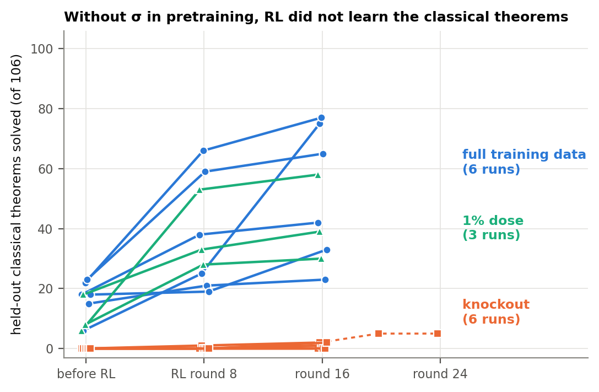
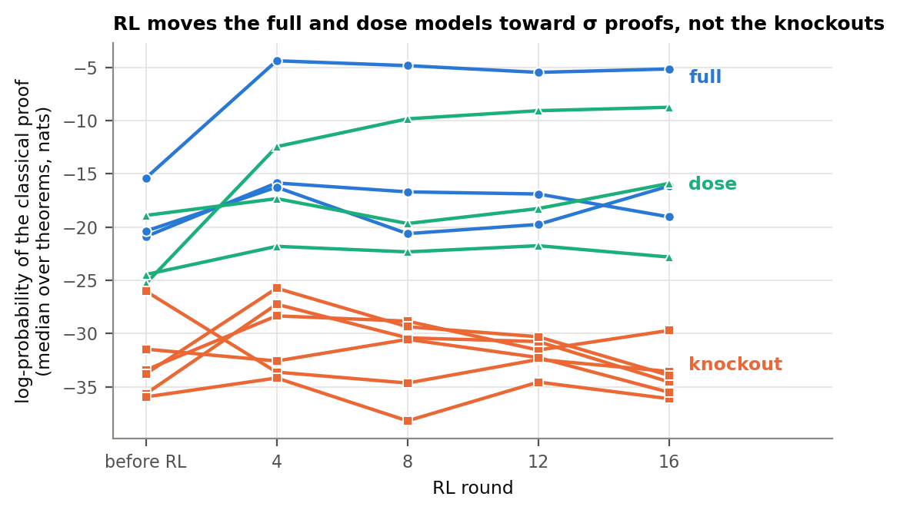
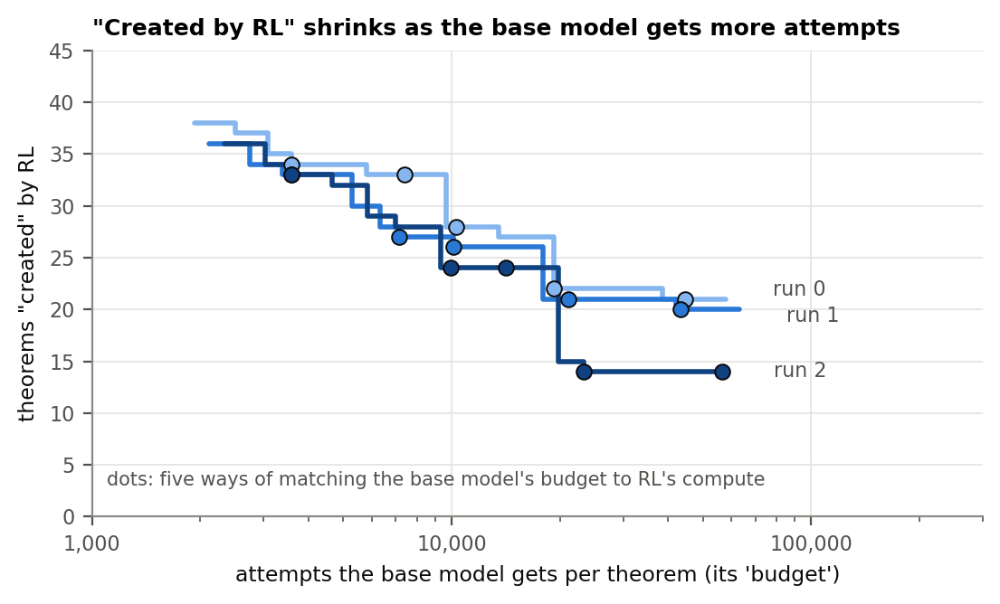
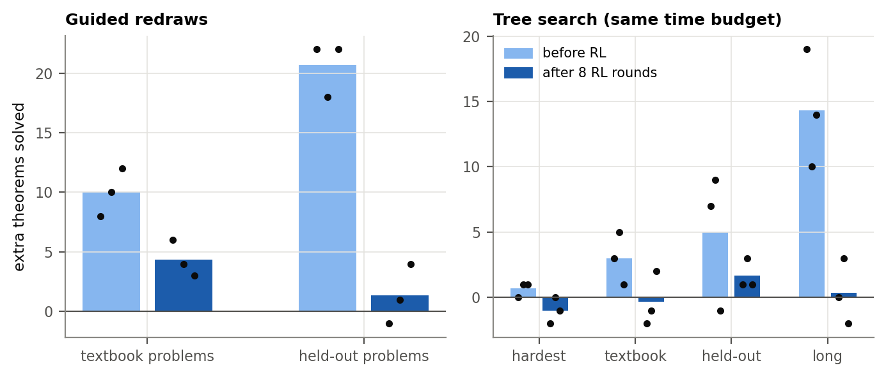

# Did RL create it? We deleted one reasoning move from a small prover's training data

*Draft for Dan, 2026-10-14. Not for circulation.*

*Epistemic status: one small model (9.6 million parameters), one kind of logic, one simple RL algorithm, six runs per
main condition and three for one extra condition. The main test was pre-registered, and someone who had not written the
code recounted the experiment's numbers from the raw files; later analyses are labelled. I would not generalise this to large
language models without more work.*

**The short version.** We trained a tiny theorem prover from scratch twice: once on data that included one classical
reasoning move (a kind of proof by contradiction that weaker logics reject), and once with every example of that move
and its close variants deleted and the data topped back up to the same size. On each we ran six runs ("seeds") of the
same simple form of reinforcement learning (RL), expert iteration. A family is the set of instances of one classical
law, such as "P or not P"; a run learns it by proving at least half of the family's unseen instances that require the
move, given 256 attempts each. With the move in its data, five of six runs learned a new family during RL (a comparison
we chose after seeing the data; the pre-registered test, 6 of 6 against 0 of 6, is mostly decided before RL). Without
it, no run learned any family in 16 rounds, and putting it back into 1% of the data restored the learning in three runs
of three (exploratory). Yet most models trained without the move could still make it, a handful of times in about a
million tries. In this small model organism (a system we fully control), this form of RL learned classical families
when pretraining had exposed the move, and did not, within 16 rounds, learn them without it. One caveat matters a lot:
a closely related study found the opposite with another RL algorithm (GRPO), so our result may be specific to ours.

## 1. The question

Reinforcement learning against a verifier is now the standard way to improve reasoning models. Does it *create*
abilities the original ("base") model never had, or only *elicit* abilities it already had, by making rare good
behaviour common? A base model that succeeds once in a million attempts will almost certainly show nothing in 1,000
samples, so "the base can't" always means "can't within some number of attempts", and that number should be stated.

## 2. A prover small enough to edit

Our 9.6M-parameter transformer proves propositional-logic theorems, built from atoms like P and Q with
"and", "or", "implies" (→) and "not" (¬). It writes one inference step at a time, and a proof counts only if Lean, a
proof checker, accepts it. We pretrain it from scratch on 155,000 machine-generated proofs, then run expert
iteration: each round, it attempts each of 4,495 training theorems 32 times and is fine-tuned on the proofs
Lean accepts.

**The move we deleted.** Classical logic allows a proof by contradiction that weaker ("intuitionistic") logic does not:
to prove S, assume "not S", derive a contradiction, conclude "not not S", then drop the double negation. We call this
σ (sigma). Here is one in Lean, written by a model pretrained without σ:

```lean
theorem t (P R S : Prop) (h1 : ¬S → ¬P) (h2 : P) : R → S := by
  have n9 : R → S := (fun (n3 : R) => by
    have n7 : ¬¬S := (fun (n4 : ¬S) => by      -- assume ¬S ...
      have n5 : ¬P := h1 n4
      exact n5 h2)                              -- ... contradiction, so ¬¬S
    exact Classical.byContradiction (fun hh => n7 hh))   -- drop the double negation: σ
  exact n9
```

*(Simplified by hand from the model's output, which also restates the premises; Lean accepts both and rejects the
same proof of the opposite claim.)*

Using σ where a problem supplies a double negation, or asks for a "not" statement, is not genuinely classical. The
genuinely classical use proves a positive statement with no double negation supplied, and only it, or a roundabout
route to the same effect, proves the theorems we test.

About 11% of the original training proofs use σ or a close variant. We made three training sets:
- **Full:** the original 155,000 proofs.
- **Knockout:** the 16,961 proofs using σ or a variant replaced by fresh proofs from the same generator. "Assume and
  refute" and "drop a double negation" still appear separately, 2.9 and 4.2 times more rarely.
- **1% dose:** the knockout set with 1,550 σ proofs put back.

We test learning on six families of classical theorems, such as excluded middle, converse contraposition and Peirce's
law, holding out 105 instances that only a genuinely classical step can prove, plus one similar theorem.

## 3. What happened



*Figure 1. Held-out classical theorems proved (of 106; 256 attempts each) by each run before RL and after 8, 16 and
(one knockout run) 24 rounds. Blue: full. Green: 1% dose. Orange: knockout.*

- **Full data:** during RL the six runs gained 8 to 69 of the 106, and five of six learned a new family. Converse
  contraposition was already learned *before* RL on five of the six, so the cleanest comparison is the during-RL one.
- **Knockout:** the six runs gained 0 to 2, and none learned any family.
- **Statistics:** the pre-registered test (at least one family by round 16: six of six against zero of six) gives
  p = 0.00024 but is mostly decided before RL. The during-RL comparisons were added afterwards: the gains do not
  overlap (p = 0.0011); new families, five of six against zero of six (p = 0.0032); on the three full runs with the
  knockout runs' hardware the gains still separate (p = 0.012), though new families there are two of three against
  zero of six (p = 0.034).
- **1% dose:** all three runs learned families during RL and proved 30 to 58 of the 106, inside the full runs' range.

RL also replays old pretraining data, so the full runs kept seeing σ during RL and the knockout runs did not; we can't
tell whether exposure mattered in pretraining or in that replay.

**Checks.** Length limits cut off up to 9% of a run's attempts on the 106. Fresh evaluations of ten models after 16
rounds with standard and with doubled limits differed by at most one theorem per model and in no family result, though most cut-off
attempts stayed cut off (missing a pre-registered prediction). Independent Lean re-checks accepted every counted proof
they examined, and a syntax filter run before Lean rejected no Lean-valid proof among the 210,151 distinct texts
it rejected in one knockout run's RL; section 4's million-try samples kept no rejected texts to check.

## 4. "Absent" is not quite right

**They could make the move, rarely.** Before RL, we sampled each knockout model 1.1 to 1.5 million times on the held-out
theorems. Five of six (four, counting only family members) proved some of them with a genuinely classical σ,
one to seven times, almost all in one family (converse contraposition); on the other five families, the six models
together managed one in 6.7 million tries. With guided redraws (section 6), four of the six proved one within 256
attempts. Only one model had zero successes in 1.5 million tries, enough to certify statistically that its average rate is
below what RL's compute could find, but only for plain sampling at our usual temperature and for one way of turning
RL's compute into a budget of attempts (section 5): at a higher, more random temperature, plain sampling proved the one
extra held-out theorem on this model and on one other. We had predicted at least five of six would certify. Our pre-registered rule
could not have returned "created": that needed a certificate for a single family, and at about 10,000 attempts per
theorem none could be certified.

**They practised it where the double negation was given.** From the first round, every knockout run used σ or
a variant on problems that supplied the double negation (thousands of accepted proofs over 16 rounds), and almost never
the genuinely classical form. A back-of-envelope calculation fits: at a few successes per million or less, about 3,900
attempts per round on the 123 training theorems that need a genuinely classical step yield at most about 0.03 per
round. In a check added afterwards, three of the six runs did better than this predicts, so RL probably nudged the rate
up. None learned a family.

**Likelihoods.** We can compute how likely a model is to write a given proof (in one of 33 equivalent spellings; the
true value is at most 3.5 natural-log units lower, and may be higher). For the best known σ proof of each held-out
theorem (found by the three earlier full runs of section 5, not each model's own), the median log-probability is −15 to
−21 for the full models before RL and −26 to −36 for the knockout models: roughly a hundred to a billion times less
likely. The 1% dose models score −19 to −25, overlapping the full ones, yet the closest dose and knockout models,
within 0.7 units, went on to prove 58 and 2 of the 106.



*Figure 2. Median log-probability (higher = more likely) of the best known σ proofs, from the end of pretraining
through round 16, for 12 of the 15 runs (all but section 5's three earlier full runs).*

**The one knockout run that moved.** One knockout run wrote ever more genuinely classical proofs, a few per round from
round 9 and 123 per round by round 24 (past the planned 16), but never learned a family: at rounds 20 and 24
it proved the same five held-out theorems, just more reliably. An early-stopped sample (sampling on a theorem paused
after its first success in each block of 1,024 tries) had found four of the five before RL; a fresh, larger one
(18,432 tries each) found only two, and none of the three that improved most. We had committed in advance to dropping
the reading that it mostly amplified theorems its pre-RL model already proved at a useful rate (at least 2 successes in
18,432 tries) if at most one of three named theorems among the five passed that bar. Only one did, so we drop it.
Whether this is eliciting a rare behaviour or creating a new one is, honestly, unclear.

## 5. Why "created" depends on how you count

The usual test gives the base and the RL model the same number of attempts, say 256, and calls anything only the RL
model solves "created". On three earlier full-data runs (three of the six in section 3, each base against its model
after 8 RL rounds), that labels 51 to 60 of 322 evaluation theorems as created.

But RL itself spent a lot of compute. Give the base that compute as attempts instead, thousands per theorem, and the
list shrinks: to 14 to 34 per run across five defensible ways of converting compute into attempts, and to 14 to 21
under all five. Of nine theorem–run pairs chosen in advance by a fixed rule and sampled over a million times each, four
survive every control at one of those budgets.



*Figure 3. Theorems the RL model solves that its base can't reach within K attempts per theorem (three runs). Dots: the
five conversions; crosses: equal attempts (256).*

Our recommendation for anyone claiming RL created something: report the result as a curve over the base's budget,
include a control that gets RL's training without RL's proofs, and say which number of attempts "never" means. Here,
such a control (fine-tuning on replayed pretraining data alone) recovered 13% to 25% of RL's gain.

## 6. Thinking harder at test time

If RL mostly makes good-but-rare proofs common, extra compute at test time should help the base model more than the
RL model. On section 5's three runs, before and after 8 RL rounds, it did. *Guided redraws* (a checker rejects a
logically wrong step and the model tries again), at about twice the compute per attempt, halved the gap between base
and RL model on one held-out set. *Tree search* over partial proofs, at equal time, recovered 14% to 44% of what eight
RL rounds add for the base, depending on the problem set; for the RL model it stayed within ±3 theorems of plain sampling everywhere
and failed the test we had set in advance on the hardest problems (those neither model had solved). But with guided
redraws the base proves only 3, 4 and 1 of the 22, 21 and 14 theorems still counted as created at one of section 5's
budgets.



*Figure 4. Extra theorems over plain sampling from guided redraws (left) and tree search (right), before RL (light) and
after 8 RL rounds (dark); dots are runs. "Long": 100 theorems of 13–16 lines. After RL the model already solves 236–240
of the 250 held-out problems, so the textbook problems are the fairer comparison.*

## 7. What we did not show

- **One small model on propositional logic.** Large models may behave differently.
- **One RL algorithm, 16 rounds.** Ours fine-tunes on its own successes (rejection-sampling fine-tuning). In the
  closest related study GRPO built behaviour pretraining lacked while methods like ours stalled, and in our earlier,
  smaller models (3.2 million parameters, whole proofs, older checker; checkpoints since lost) GRPO started a different
  pattern from zero. Here, from full data, plain GRPO solved fewer theorems than our method (which also re-reads old
  training data), and a coverage-rewarding variant about as many. GRPO from the knockout models has not been run.
- **Six runs per main condition.** Enough for the main comparison, not for most single-family tests. Per family, only
  converse contraposition, which most full models already had before RL, passes our pre-registered "needs exposure"
  test; three more families, at 3 full runs against 0, stay undecided after correcting for six tests.
- **The knockout isn't perfectly clean.** It made σ's ingredients rarer and cost a few non-classical theorems; the 1%
  dose, which changes the data far less, restored the learning.
- **A null we can't interpret.** Our implementation of "power sampling", which sharpens the base model without training,
  proved none of RL's new solves (two earlier full runs' bases) or of the 106 held-out classical theorems (two knockout
  bases). It also did worse than plain sampling on
  theorems the base solves rarely, so we count it as a failure of our sampler.

Code, data and checkpoints are public; the paper is a draft.
