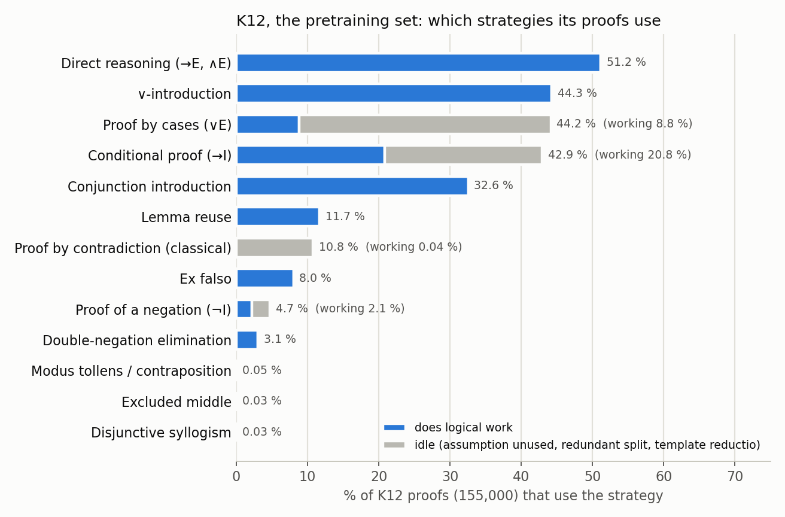
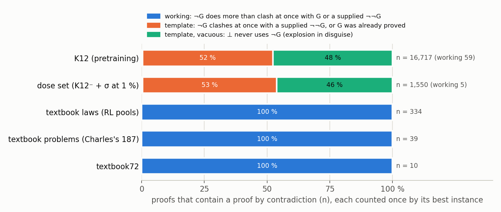
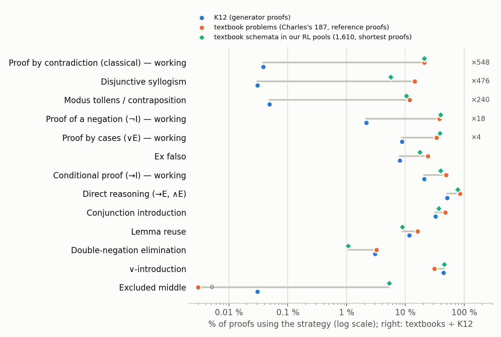

# What kinds of reasoning are in our prover's training data?

*Draft for Dan, 2026-10-18. Not for circulation.*

*Epistemic status: counts over data files, plus one section re-reading our models' proofs. Each strategy is a checkable
rule; AI agents checking 260 proofs by hand (two labels each) agreed with the classifier before their notes tightened two
rules, and a program written from the definitions alone agrees on all 155,000 K12 proofs. Numbers: `TABLES.md`;
definitions: `TAXONOMY.md`.*

**The short version.** Our small theorem provers are *pretrained* (trained from scratch, before reinforcement learning)
on K12: 155,000 propositional-logic proofs written by a program. We labelled every proof with the strategies a logic
textbook would recognise.
- **Many K12 proofs contain idle steps.** 38 % split into cases where one case never uses its own
  assumption, so the split could be deleted.
- **Proof by contradiction, the move our knockout experiment removed (called σ there), almost never does any work in
  K12.** It appears in 10.8 % of proofs, but in only 59 of those 16,717 does the assumption "not G" (G the goal) do more
  than clash at once with G or a stated "not not G", none on a theorem that needs it.
- **Textbook problems use what K12 lacks.** In 187 textbook problems, 21 % use a working proof by contradiction (K12:
  0.04 %), 38 % a working proof of a negation (2 %) and 12 % modus tollens (0.05 %).

The full (non-knockout) models thus saw the *form* of proof by contradiction, almost never its use, and wrote working
ones anyway: the three we analysed wrote 27–45 *free* ones each (defined below) before any RL update and 5,915–22,013
more over 15 rounds of RL.

## The setting

A proof here is a *natural deduction* proof: numbered lines, each following from earlier lines by one rule. Some rules
open a *box*: you assume something temporarily, reason inside it, then close it and *discharge* the assumption. Exactly
one rule is *classical*: double-negation elimination (from "not not G" infer G). Logic without it is *intuitionistic*.
Every proof can be written in Lean, a proof checker; Lean decides what counts.

In the Lean examples, `example (h : A) : B := t` says t proves B from A, `fun a => t` assumes a, `h.elim` splits an "or"
into cases, `⟨a, b⟩`, `h.1` and `Or.inl` / `Or.inr` build or take apart "and" and "or", `have l : X := t; …` proves a
lemma l, `¬A` means A leads to `False`, `False.elim` is ex falso and `Classical.byContradiction` the classical step.

K12 has about 14,100 proofs at each length from 2 to 12 lines. Create-or-elicit, our "Did RL create it?" experiment,
pretrained models on K12 (the *full* arm) or on K12⁻ (the *knockout* arm): K12 minus the 16,961 proofs with σ or a close
variant, topped up to 155,000.
It then trained them by *expert iteration*, a simple form of reinforcement learning (RL): try each training problem 32
times, keep what Lean accepts, fine-tune, repeat. A *seed* is one trained model.

## A field guide

A *strategy* is an inference pattern with a standard name (mostly *forall x: Calgary*'s, a free textbook). A proof
*uses* every strategy whose pattern it contains, so the shares below overlap; examples are from K12 unless noted.

1. **Direct reasoning** (modus ponens: from A and "if A then B" infer B; ∧-elimination), 51 %. From "P and Q", conclude P:
   `example (P Q : Prop) (h : P ∧ Q) : P := h.1`
2. **Conjunction introduction** (prove each half), 33 %:
   `example (P Q : Prop) (h : P) : P ∧ (P ∨ Q) := ⟨h, Or.inl h⟩`
3. **Conditional proof** (to prove "if S then …", assume S), 43 %:
   `example (Q S : Prop) : S → S ∨ Q := fun s => Or.inl s`
4. **∨-introduction** (prove one side of an "or"), 44 % (no classical step: "not S" is given):
   `example (S : Prop) (h : ¬S) : S ∨ ¬S := Or.inr h`
5. **Proof by cases** (use an "or" by handling each side), 44 %:
   `example (P S : Prop) (h : P ∧ S ∨ S) : S := h.elim (fun c => c.2) (fun s => s)`
6. **Disjunctive syllogism** (one case is impossible, so the other holds), 0.03 %:
   `example (P Q S : Prop) (h1 : ¬¬S) (h2 : ¬S ∨ P) : (Q ∨ S) ∨ P := h2.elim (fun n => False.elim (h1 n)) Or.inr`
7. **Proof of a negation** (¬I: assume A, reach absurdity, conclude "not A"), 4.7 %:
   `example (R : Prop) (h : ¬(R ∨ ¬R)) : ¬¬R := fun n => h (Or.inr n)`
8. **Modus tollens** (from "if R then S" and "not S", conclude "not R"), 0.05 %:
   `example (R S : Prop) (h1 : ¬S) (h2 : R → S) : ¬R := fun r => h1 (h2 r)`
9. **Ex falso** (from a contradiction anything follows), 8 %:
   `example (Q R : Prop) (h1 : Q) (h2 : ¬Q) : R := False.elim (h2 h1)`
10. **Proof by contradiction** (assume "not G", reach absurdity, conclude G; classical), 10.8 %. Below.
11. **Double-negation elimination** on a double negation the problem supplies (classical), 3.1 %:
    `example (Q R : Prop) (h : ¬¬(Q ∨ R)) : Q ∨ R := Classical.byContradiction h`
12. **Excluded middle** (prove "X or not X" by contradiction; classical), 0.03 % (example in `EXAMPLES.md`).
13. **Lemma reuse** (prove a fact once, use it twice), 12 %:
    `example (P Q R : Prop) (h : Q → P) : (¬¬(Q → P) ∨ R) ∧ ¬¬(Q → P) := have l : ¬¬(Q → P) := fun n => n h; ⟨Or.inl l, l⟩`

Items 6 and 8 are (mostly) special cases of 5 and 7. Items 7 and 10 are both called "reductio", but only 10 is
classical; below, "reductio" means 10.

## What K12 is made of



Grey: proofs in which every instance is idle (the 28 % and 38 % below count proofs with any idle step). Three generator
habits:
- 28 % of proofs assume something they never use (proving "if A then B" without using A).
- 38 % contain a case split in which one case ignores its own assumption.
- 24 % of the problems have contradictory premises, from which ex falso proves anything.

Re-proving 990 K12 problems with a shortest-proof search shortens proofs by a third and removes the idle splits
(35 % → 0; proof by cases 43 % → 6 %), but most unused assumptions stay (29 % → 23 %; a goal "if A then B" with an
irrelevant A forces one), and the problems' contradictory premises get used more (6 % → 16 %).

## Most of K12's proof by contradiction is a template

We sorted each proof by its best reductio:



In K12, 16,658 of the 16,717 proofs with a reductio contain only templates, of three kinds:
- **Vacuous:** the absurdity, usually from contradictory premises, never uses "not G": ex falso in disguise.
- **Supplied:** "not G" clashes at once with a "not not G" the problem states: double-negation elimination in
  disguise.
- **Pointless:** G had already been proved.

Each kind has an example in `EXAMPLES.md`. One of the 59 working ones:

```lean
example (R S : Prop) (h1 : R ∨ ¬R ∨ ¬S) (h2 : ¬(¬R ∨ ¬S)) : (R ∨ ¬R ∨ ¬S) ∧ R :=
  ⟨h1, Classical.byContradiction (fun (a1 : ¬R) =>
    h1.elim (fun (a2 : R) => a1 a2) (fun (a3 : ¬R ∨ ¬S) => h2 a3))⟩
```

It splits on the first premise: R contradicts "not R", and the other case the second premise. Even
this is avoidable: all 59 working reductios are on theorems provable without the classical rule (48 prove a "not").

The theorems agree. K12's 6,238 *classical-only* theorems (provable only with the classical rule) all state a double
negation and were proved by eliminating it or by a template reductio. None is *σ-covered* (classical-only with no double
negation anywhere, so that every proof needs a working reductio).

## What textbooks use that K12 lacks

We compared K12 with three textbook-like sets:
- 187 problems from logic textbooks such as *forall x*, collected by a colleague (Charles), with his reference proofs
  (173 minimal ones found by search, 14 written by hand);
- 1,610 instances of textbook laws (De Morgan's, Peirce's, …) from our RL training and evaluation pools;
- textbook72, 72 textbook problems held out from training and never printed (6 K12 records match some up to renaming, premise order or currying).

For the last two our search found Lean-checked shortest proofs (for 58 of the 72).



| strategy (share of proofs that use it) | 187 textbook problems | K12 |
|---|---|---|
| working proof by contradiction | 21 % | 0.04 % |
| modus tollens | 12 % | 0.05 % |
| disjunctive syllogism | 14 % | 0.03 % |
| working proof of a negation | 38 % | 2 % |
| genuine case analysis (every case used) | 34 % | 9 % |

The law instances and textbook72 agree (they share some laws). The theorems differ too:
- 19 % of the 187 textbook problems are σ-covered, against none in K12.
- Of the 124 textbook problems a bounded search could settle, 37 % need a negation introduction (¬I or a reductio) in
  every short proof; of a K12 sample, 3.7 %.

## What this means for the knockout result

Create-or-elicit found that the classical *families* (the instances of one classical law, such as excluded middle) need
σ in pretraining. After 16 rounds of RL, a family was acquired (at least half its held-out σ-covered instances solved in
256 tries) on 6 of 6 full seeds (5 before RL), 0 of 6 knockout seeds, and 3 of 3 seeds pretrained with σ at 1 % of the
set (1 before RL; exploratory). K12 holds 59 working reductios (6 free); the 1 % dose set holds 5 (2 free), and its seeds
acquired families anyway.

We classified every distinct proof found by 12 of create-or-elicit's 15 RL runs (three are older) by the round it
was first found, counting *free* working reductios, the kind σ-covered problems need (positive goal, no double
negation supplied):
- **Round 1** (the pretrained models): the three full models wrote 38, 27 and 45, proving 17, 15 and 20 of the 123
  σ-covered problems.
- **Rounds 2–16**: 22,013, 7,886 and 5,915 more; 78, 33 and 36 σ-covered problems by round 16. Dose models: 13, 43 and
  7, then 9,047–15,731.
- **Knockout models**: none in round 1, then 0–32, proving at most 5 σ-covered problems. Their other working reductios
  mostly lean on a double negation the problem states. (Create-or-elicit's larger "free" counts include templates.)

So pretraining supplied the *form* (assume "not G", close the box, drop the double negation), and the models put it to
work: rarely before RL (0.15–0.27 % of the full models' proofs), more often in round 16 (1.2–3.9 % of that round's new
proofs), and where needed on 33–78 of the 123 σ-covered problems. Both arms saw both halves of the move, working proofs
of a negation (2 % of each set) and eliminations of a stated double negation (3 %); the knockout removed only their
combination. This is our reading, not a tested result.

## Caveats

- Labels describe the proofs we have (a generator's, a search's or Charles's); another proof could differ. The
  theorem-level checks guard against this (classical-only exactly, necessity within 12 lines).
- "Working" means the assumption does logical work; for a reductio, more than a clash with G or a supplied "not not G".
- The knockout reading rests on 15 models of one small architecture (9.6 million parameters): 6 full, 6 knockout, 3
  dose; our RL counts use 12 (3 full, 6 knockout, 3 dose).
