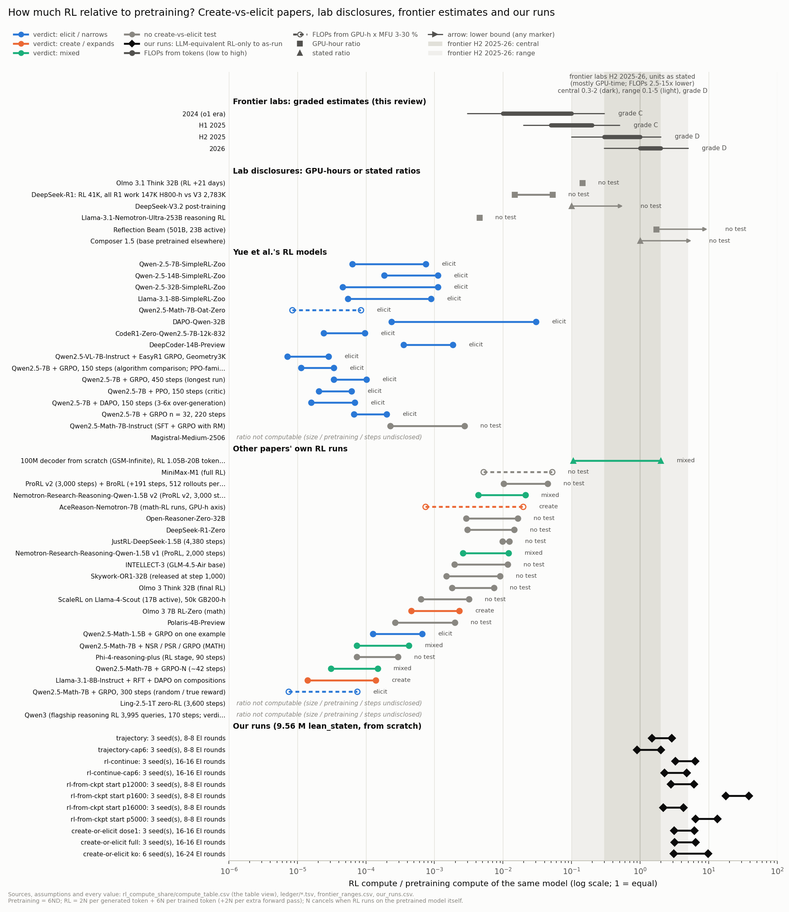

# How much RL do create-vs-elicit papers run, relative to pretraining? (run `rl-compute-share`, 2026-10-19)

This review extends `lit-review`, `lit-review-2` and `capabilities` and does not re-screen them.

**Coverage.** We screened **96 sources** (52 arXiv, 44 web; more than the brief's 30–45, as Q3 rests on short
lab statements), with **13 in-depth notes** ([`notes/`](notes/)): 12 sources read in full (Yue by me) and one note
on 12 frontier posts.

**Verification.**
- Every source figure has a verbatim quote in [`ledger/*.tsv`](ledger/). `verify_ledger.py` finds 1,206 / 1,206 of
  them, and `check_quotes.py` finds every quotation here and in the notes. Both fail on altered controls.
- A 41-row spot check matched values to quotes.
- Two adversarial checks found 51 and then 13 problems; all are addressed (`_claimcheck.md`, `_claimcheck2.md`).

**Method.** Pretraining = 6·N·D, with N the active parameter count. RL = 2·N per generated token, plus 6·N per trained
token, plus 2·N per extra forward pass, plus any critic.
- **N cancels** when RL runs on the pretrained model itself.
- **Unreported mean lengths** are bounded by ¼–1 × the maximum or by a figure's axis. R1-Zero's low bound uses ⅛,
  because its length curve starts near zero. With ¼, its GPU-time / FLOP factor below would be ≈ 4×.
- **Attention FLOPs are ignored**, which undercounts long-context RL by at most ≈ 2×.

Rows: [`compute_table.csv`](compute_table.csv).

## Bottom line

1. **Yue et al.'s RL is 7 × 10⁻⁶ to 3 × 10⁻³ of pretraining FLOPs; the median is 1.2 × 10⁻⁴.**
   - DAPO-32B reaches 3 × 10⁻² only under a step reading its caption contradicts.
   - The median sits 3.4–4.2 orders below the frontier's H2 2025–26 central range (0.3–2, labs' units), or ≈ 2.5–3.5
     if those units are GPU-time.
2. **No create-vs-elicit test on a pretrained LLM with a computable ratio exceeds ≈ 2 × 10⁻²** (ProRL v2, AceReason-7B;
   3 × 10⁻² for DAPO under the contradicted step reading).
   - Magistral, Ring-Zero and Qwen3 were tested, but their ratios cannot be computed.
   - Larger shares come only without a test: MiniMax-M1 (≤ 5 × 10⁻²), Olmo 3.1 (14 % of GPU-hours), DeepSeek-V3.2
     (> 10 % of cost) and Reflection Beam (≥ 1.7 by GPU-time).
3. **No frontier lab publishes an RL / pretraining FLOP ratio.** The closest statements are xAI's "at pretraining
   scale" and DeepSeek-V3.2's.
   - Graded estimate: 0.01–0.1 in 2024 (C), 0.3–1 in H2 2025 (D), ≈ 1–2 in 2026 (D).
   - 2024–H2 2025 rest partly on Epoch's FLOP estimates. 2026 rests mostly on GPU-time and fleet statements, which
     overstate FLOPs 2.5–15× (5–8× at the midpoints of R1-Zero and Olmo 3).
4. **The scale evidence within studies is mixed.**
   - The largest-k re-tests narrow or plateau with more RL.
   - ProRL (code, boxnet), Interplay (out-of-distribution hard) and our rl-continue grow.
   - Both controlled frontier-share tests that remove a skill from pretraining find "needs exposure": Interplay
     (≈ 0.4×) and our knockout (3–10×).
5. **Our runs spend 0.9–19× pretraining FLOPs on RL** (RL share only; up to 39× as run) and 9–180× by GPU-time. That
   is at or above the frontier band.

**Verdict: supported.** The papers test RL 0.6–4 orders of magnitude below the frontier
share, so they cannot rule out creation there. That gap is a missing measurement, not evidence of creation at scale.

## Q1. Yue et al. in numbers

Yue evaluates ten outside checkpoints (nine computable) and trains nine runs: six algorithms, two ablations and
EasyR1.

| model (base, D) | RL run | RL / PT FLOPs |
|---|---|---|
| SimpleRL-Zoo Qwen2.5-7B/14B/32B, Llama-3.1-8B (18T; 15T) | ~100–150 steps × 1,024 × 8, max 8,192 | 4.6 × 10⁻⁵ – 1.1 × 10⁻³ |
| Oat-Zero-7B (Qwen2.5-Math, 19T) | 27 h × 8 A100 | 8 × 10⁻⁶ – 8 × 10⁻⁵ (FLOPs from GPU-hours, MFU 3–30 %) |
| DAPO-32B (18T) | 512 × 16, max 20,480; 312 or 5,000 rollout steps | 2.4 × 10⁻⁴ – 1.9 × 10⁻³ (3.0 × 10⁻² rollout-step reading) |
| CodeR1-Zero-7B (Instruct-1M) | 832 × 16 × 16, max 4,096 | 2.4 × 10⁻⁵ – 9.7 × 10⁻⁵ |
| DeepCoder-14B (R1-Distill) | 32 H100 × 2.5 weeks, mean 8K → 17.5K tokens | 3.6 × 10⁻⁴ – 1.9 × 10⁻³ |
| Yue's VeRL runs, Qwen2.5-7B | 150–450 steps × 256 × 8; n = 32 for 220 steps | 1.1 × 10⁻⁵ – 2.0 × 10⁻⁴ |
| Yue's EasyR1 run, Qwen2.5-VL-7B | defaults assumed | 7 × 10⁻⁶ – 3 × 10⁻⁵ |
| Qwen2.5-Math-7B-Instruct (Fig. 7 baseline) | 66K queries × 32, steps assumed | 2.3 × 10⁻⁴ – 2.7 × 10⁻³ |
| Magistral-Medium | base size, steps, GPU-hours undisclosed | not computable |

- **DAPO's axis** is captioned "gradient update steps", with 16 updates per rollout step [A-DAPO-steps-unit,
  A-DAPO-minibatch].
- **Tokens and GPU-hours.** Rollout tokens are ≤ 5.5 × 10⁻² of D (median high 2.5 × 10⁻⁴). Five checkpoints report
  216–13,440 GPU-hours; of the bases, only Llama-3.1-8B does (1.46M) [A-LLAMA-gpu-hours].
- **Contamination.** Qwen2.5 pretraining includes synthetic maths [A-Q25-synth]. Code-R1, EasyR1 and Magistral start
  from instruct models, and DeepCoder from an R1 distillation [A-R1D-card].
- **Yue's caveat.** "Whether this trend persists as more compute, such as pre-training scale budgets, is dedicated to
  RL training remains a critical question" [Y-yue-open-question].
  - Magistral-Medium, which they evaluate, shows "little or no improvement at higher k" [Y-yue-magistral-result]; its
    RL share is unknown.

## Q2. The wider literature

The 35 runs on pretrained LLMs with a computable ratio, grouped by the verdict about each model (geometric midpoints;
`analysis_out.txt`):

| verdict | n | median | examples (low – high) |
|---|---|---|---|
| elicit / narrows | 16 | 8.7 × 10⁻⁵ | Yue's models; spurious rewards 7 × 10⁻⁶ – 7 × 10⁻⁵; one-shot RLVR 1.3 – 6.6 × 10⁻⁴ |
| create / expands | 3 | 1.0 × 10⁻³ | f(g(x)) 1.4 × 10⁻⁵ – 1.4 × 10⁻⁴; Olmo 3 RL-Zero 4.6 × 10⁻⁴ – 2.3 × 10⁻³ (pass@32); AceReason-7B 7 × 10⁻⁴ – 2 × 10⁻² |
| mixed | 4 | 2.9 × 10⁻³ | ProRL v1 2.6 × 10⁻³ – 1.2 × 10⁻²; ProRL v2 4.4 × 10⁻³ – 2.1 × 10⁻²; NSR; GRPO-N |
| no test | 12 | 4.2 × 10⁻³ | MiniMax-M1 5 × 10⁻³ – 5 × 10⁻²; ProRL v2 + BroRL 1.0 – 4.5 × 10⁻²; JustRL ≈ 10⁻²; ORZ-32B 3 × 10⁻³ – 1.6 × 10⁻²; R1-Zero 3 × 10⁻³ – 1.5 × 10⁻² |

- **Create vs elicit:** the medians differ 11.8× (n = 3 create; ranges overlap). The largest recipes test nothing.
- **Interplay** (100M, from scratch) is the one paper whose RL reaches the frontier band: 0.1–2× its 10B pretraining
  tokens, in token equivalents [C-INTER-budget_row_1, C-INTER-budget_row_20, C-INTER-pretrain_tokens].
  - In-distribution pass@128 never improves [C-INTER-verdict_id].
  - Edge-of-competence RL gains up to +42 % [C-INTER-plus42]; new contexts gain up to +60 % with ≥ 1 % pretraining
    exposure [Y-inter-plus60].
- **Lab disclosures** (claim ids in `compute_table.csv`):

  | lab | basis | RL / pretraining |
  |---|---|---|
  | DeepSeek-R1 | GPU-hours | 1.5–5.3 % |
  | DeepSeek-V3.2 | post-training cost | > 10 % |
  | Llama-Nemotron-Ultra | GPU-hours | 0.45 % |
  | Olmo 3.1 Think 32B | GPU-hours | 14 % |
  | Reflection Beam | GPU-time | ≥ 1.7 |

## Q3. Frontier reference points (graded)

| date | source | statement | grade |
|---|---|---|---|
| 2024-09 | OpenAI, o1 | performance rises with RL train-time compute | A [D-oai-o1-rlscaling] |
| 2025-01 | Amodei | RL spend "small for all players"; "$1M instead of $0.1M" | A-informal [D-ant-amodei-rlsmall] |
| 2025-01 | Epoch (Erdil) | R1-Zero's RL ≈ 6.1 × 10²³ FLOP, ≈ 20 % of V3 | C [D-epoch-r1-rlflop] |
| 2025-04 | OpenAI, o3 | "an additional order of magnitude" of training compute via RL | A, relative [D-oai-o3-10x] |
| 2025-07 | xAI, Grok 4 | RL "at pretraining scale" on 200k GPUs | A [D-xai-grok4-ptscale] |
| 2025-10 | Epoch | early 2025 RL 1–10 % of pretraining; GPT-5 RL assumed 10–200 % | C [D-epoch-gpt5notes-early25, D-epoch-gpt5notes-range] |
| 2025-12 | DeepSeek-V3.2 | post-training budget "exceeding 10% of the pre-training cost" | B [B-V32-ratio_stated-intro] |
| 2026-02 | Cursor, Composer 1.5 | post-training exceeds the base's pretraining | A, not frontier [D-cursor-c15-ratio] |
| 2026-08 | OpenAI | "largest planned frontier RL run remains on hold" | A, qualitative [D-oai-pause-frontierrl] |
| 2026-10 | SemiAnalysis, fleet shares | post-training 42 % vs pretraining 23 % (1Q26) | D [D-oc-sa-posttrain, D-oc-sa-pretrain] |

**Graded per-model range** ([`frontier_ranges.csv`](frontier_ranges.csv)):

| period | central | range | grade |
|---|---|---|---|
| 2024 | 0.01–0.1 | 0.003–0.3 | C |
| H1 2025 | 0.05–0.2 | 0.02–0.5 | C |
| H2 2025 | 0.3–1 | 0.1–2 | D |
| 2026 | 1–2 | 0.3–5 | D |

That is 1–2 orders of magnitude in two years, in mixed units. H2 2025 rests partly on Epoch's FLOP estimates; 2026 on GPU-time and
fleet statements, which read as FLOPs give ≈ 0.1–0.4.

**Cautions.**
- **Units.** GPU-time overstates RL's FLOP share 2.5–15×: R1-Zero is 3.6–3.8 % by GPU-hours but 0.3–1.5 % by FLOPs.
  Beam's ≥ 1.7 means ≥ 0.27–0.35 on the trainer side [D-refl-beam-split]. Fleet shares include experiments.
- **Estimates can be far off.** At V3's 1.2 × 10¹⁸ FLOP per GPU-hour, Epoch's pre-disclosure R1-Zero count (≈ $1M at
  pretraining MFU) needs ≈ 490K H800-hours, against 101K disclosed. Our token count (1.0–4.8 × 10²² FLOP) is 13–60×
  below Epoch's.

## Q4. Does the verdict depend on RL scale?

**Reach grows:**
- ProRL's gains are sustained on code and on boxnet [C-PRORL-sustained, C-PRORL-boxnet]. On boxnet it stays ahead at
  k 16,384 (0.492 against 0.345), though the base is not at zero [C-LEASH-boxnet16384].
- In Interplay, more RL helps on out-of-distribution hard problems [C-INTER-heavyrl].
- Abdulsalam et al.'s gains "emerge late" [C-ABD-late].
- Ours, rl-continue (nd-rl `experiment-summaries/2026-10-03-rl-continue-cap12…`): 8 → 16 rounds raised group-C
  pass@256 from 0.049 to 0.265, i.e. 5 → 27 of 99 theorems the base solves 0 of at k 256. 16 of the 22 new solves
  came on one seed.
- Ours, knockout s1, r16 → r24 (`numbers.md` § create-or-elicit): free reductios went from 11 to 123 per round, and
  held-out members from 2 to 5.

**Reach plateaus or narrows:**
- **Invisible Leash**, at k 1,024–16,384: ProRL v1 gains 36 problems and loses 163; v2 gains 48 and loses 175
  [C-LEASH-prorlv1_row, C-LEASH-prorlv2_row].
- **Ring-Zero** (1T parameters; tracked to step 2,000; ratio unknown): pass@1024 "increases during the initial phase of
  training but eventually plateaus" [C-RING-verdict].
- **Yue's 150 → 450 steps:** pass@256 falls from 66.3 to 64.3 while pass@1 rises
  [Y-yue-verl-step150, Y-yue-verl-step450].
- **Leash's own 300-step run** (R1-Distill-1.5B, k 256) is net negative on 5 of 6 benchmarks [C-LEASH-ckpt_5of6].

**Skills removed from pretraining, at frontier-share RL:**
- Interplay at ≈ 0.42× pretraining: "RL fails to transfer" with 0 % or 0.1 % exposure [Y-inter-exposure,
  C-INTER-budget_row_4p2].
- Our knockout at 3–10×: 0 / 6 seeds reach a family bar in 16 rounds, against 6 / 6 full seeds. A 1 % dose restores
  acquisition.

**Allocation matters even at tiny RL:**
- composition data: f(g(x)) at ≤ 1.4 × 10⁻⁴ [C-FGX-verdict];
- negative samples: GRPO-N takes AIME25 from 14 to 20 of 30 at k 256, where GRPO stays at 14 [C-DEBATE-aime25_base,
  C-DEBATE-aime25_grpo, C-DEBATE-aime25_grpon].

Spurious Rewards scopes its claim to "the compute scales of open-source post-training pipelines" [C-SPUR-verdict].

**Which normaliser?**
- **Trained tokens and FLOPs agree within 2–3×** for on-policy RL on the same model: the ratio is (generated +
  3·trained + extra passes) / 3D.
- **Gradient steps are not comparable:** samples per step span 256–65,536.
- **GPU-hours overstate the FLOP share 2.5–15×.**
- **FLOPs overstate RL's information share by ≈ 10³.** Policy gradient gets "O(1) bits per episode" [C-LORA-bits],
  about 5.3M bits for R1-Zero [C-LORA-r1zero_bits], and its updates are KL-minimal [C-RAZOR-principle].
- **Exploration volume is separate from compute.** RL samples each training problem 1.5–2,400 times (2 × 10⁶ for
  one-shot RLVR; median ≈ 100), while evaluations use k = 32–16,384.
- **Recommendation: the FLOP ratio** (N-free, mappable onto lab statements to within 2.5–15×).
  - Pair it with samples per problem versus the evaluation k.
  - Add a base read at RL's compute: in `capability-defs` it cut RL's 51–60 equal-k "creations" per seed to 14–22.

## Q5. Where do our runs sit?

All runs use `best_model.ALiBiGPT` 6 × 384, 9,560,832 params, `lean_staten`, trained from scratch, then T1
expert-iteration ladders.
- **Stage 1:** 1,200 s on an A40; 4.4 × 10⁸ tokens, 2.5 × 10¹⁶ FLOP; trained on K12, cap 6, K12⁻ or the 1 % dose set.
- **rl-from-ckpt** starts at steps 1,600–16,000, so D = 2.9 × 10⁷ – 2.9 × 10⁸.
- **Source:** `our_runs.py`, which reads six runs' registries without modifying them.

| run | rounds | RL / PT FLOPs (RL-only, decoded – as run) | GPU-time ratio |
|---|---|---|---|
| trajectory / -cap6 | 8 | 1.5–2.9 / 0.9–2.0 | 12–14 / 9 |
| rl-continue / -cap6 (cumulative) | 16 | 3.3–6.3 / 2.3–4.8 | 29–30 / 22–26 |
| rl-from-ckpt, starts p16000 → p1600 | 8 | 2.2–4.3 → 18–39 | 20 → 152–182 |
| create-or-elicit full / dose1 / knockout | 16–24 | 3.2–6.4 / 3.1–6.2 / 3.1–9.7 | 33–54 |

Two costs inflate the as-run column. Each action re-reads the proof state (prefill ≈ 4.8× decoded tokens), and each
round replays 20,000 records of the arm's pretraining set. The low column counts decoded tokens and RL records only.
Even so, we sit at or above the frontier band, ≈ 4–5 orders above Yue's median.

## Verdict on the hypothesis: supported

**Why.**
- Yue's median ratio is 10⁻⁴. No tested pretrained-LLM model with a computable ratio exceeds ≈ 2 × 10⁻²
  (3 × 10⁻² under DAPO's contradicted step reading).
- The frontier has been ≥ 0.1 since H2 2025 (D). Epoch's FLOP-based estimates for Grok 4 and GPT-5 span 0.1–2 (C)
  [D-epochdb-grok4-rl, D-epoch-gpt5notes-range].
- So the papers answer the small-RL question, and Yue et al. call frontier scale open.

**What it does not imply.**
- The gap is a missing measurement, and the scale evidence within studies is mixed.
- The two controlled frontier-share tests (Interplay, our knockout) are from-scratch organisms. There, RL extends reach
  near the edge of what pretraining supports, yet still needs pretraining exposure for a skill that is absent.

## Implications for our project (ranked by value)

1. **Frame our results as frontier-share results.**
   - Our ladders started from full pretraining spend 0.9–5.1× pretraining FLOPs on RL counting RL only, or 1.9–9.7× as
     run. Early starts reach 19×.
   - Our knockout is one of two controlled create-vs-elicit tests at frontier-share RL, and the only one above 1×.
2. **Plot the scale curve from existing reads:** reach (group C, knockout members) against cumulative RL FLOPs.
   Rounds 1–24 span ≈ 0.2–10; a sub-round arm at ≈ 10⁻³ would test Dan's hypothesis directly.
3. **Report the RL-only ratio, and consider a no-replay arm.** Replay is continued pretraining (`rl-from-ckpt`).
4. **Pair every "RL created X" claim** with samples per target against the evaluation k, and a compute-matched base
   read (`capability-defs`).
5. **Quote the frontier as a graded range with units**, never as one number.

## Pre-registered expectations vs outcomes (`12753dbd`)

| # | expected | outcome |
|---|---|---|
| 1 | Yue median high < 10⁻³; SimpleRL-Zoo < 10⁻⁴; largest 10⁻³–5 × 10⁻² | **partly**: median 2.0 × 10⁻⁴ (third-party 1.1 × 10⁻³); SimpleRL-Zoo **falsified**; DAPO held |
| 2 | ≥ 4 decades; no low ≥ 0.1; biggest open runs in 10⁻³–10⁻¹; create ≥ 10× elicit | **partly**: 3.9 decades; **falsified** by Interplay (low 0.105); held but ScaleRL; R1 held; 11.8× held (n = 3) |
| 3 | no absolute OpenAI / xAI figure; 2025–26 from ≥ 10⁻² to ≈ 1; 2024 ≤ 0.1 | **partly**: held; upper edge 2–5 (D); 2024 range to 0.3 |
| 4 | none ≥ 0.1 at k ≥ 1,024; ProRL / BroRL at k ≤ 256; a ≥ 10⁻³ study narrows; ScaleRL tests no creation | **partly**: held (literature); ProRL boxnet ahead to k 16,384, BroRL untested; held; held |
| 5 | ours ≥ 0.1 (8 rounds), ≥ 1 (16+); ≥ 10× GPU-time | **partly**: trajectory-cap6 at 9× GPU-time |
| 6 | partly supported (60 %) | **partly**: label "supported"; pre-registered reason (b) held, (c) failed |
| 7 | FLOP headline, trained tokens second | **partly**: FLOP headline; samples per problem and compute-matched reads second |

Tally: 0 held outright, 7 in part.

## Screened sources (96; in-depth reads in bold)

Full rows: [`screened.md`](screened.md). Zotero list: [`to_add_to_zotero.md`](to_add_to_zotero.md).

| Q | sources |
|---|---|
| Q1 (15) | **Yue 2504.13837v5**; **SimpleRL-Zoo 2503.18892v3**; Oat-Zero 2503.20783v2; **DAPO 2503.14476v2**; Code-R1; DeepCoder; EasyR1; **Magistral 2506.10910v1**; Mistral Medium 3; Qwen2.5-Math 2409.12122v1; Qwen2.5 2412.15115v2; Llama 3 2407.21783v3; Qwen2.5-VL 2502.13923v1; Qwen2.5-1M 2501.15383v1; **DeepSeek-R1 2501.12948v2 + Nature** |
| Q2 (42) | DeepSeek-V3 2412.19437v2, V3.2 2512.02556v1, V4 2606.19348v1, V4.1-Flash; ORZ 2503.24290v2; Skywork-OR1 2505.22312v2; POLARIS; **MiniMax-M1 2506.13585v1**; MiniMax-01 2501.08313v1; Qwen3 2505.09388v1; Kimi k1.5 2501.12599v4; **ScaleRL 2510.13786v1**; **Olmo 3 2512.13961v2**; AceReason 2505.16400v3; Phi-4-reasoning 2504.21318v1; Phi-4 2412.08905v1; Llama-Nemotron 2505.00949v5; INTELLECT-2 2505.07291v1; INTELLECT-3; GLM-4.5 2508.06471v1; JustRL 2512.16649v1; Demystifying RL 2608.24949v2; Apertus 1.5 2610.15542v1; Reflection Beam; Lambert RLHF book 2504.12501v12; **ProRL 2505.24864v1**; ProRL v2 (2 NVIDIA pages); **BroRL 2510.01180v1**; **RL Squeezes 2509.21128v2**; **Invisible Leash 2507.14843v5**; NSR 2506.01347v2; f(g(x)) 2509.25123v3; Interplay 2512.07783v1; Debate 2510.04028v1; Echo Chamber 2504.07912v2; Spurious Rewards 2506.10947v2; one-shot RLVR 2504.20571v3; Tsilivis 2510.11495v2; Abdulsalam 2607.07646v1; Ring-Zero 2607.12395v2; overtraining 2606.15455v1 |
| Q3 (34; **frontier note**) | OpenAI: o1, o3, GPT-5 and RL-pause posts, Roberts talk; xAI: Grok 3, 4, 4.1; Anthropic: Amodei 2025 and 2026, Douglas & Bricken; Google: Gemini 2.5 2507.06261v6, Vinyals (press); Cursor: Composer 1.5; Epoch AI: 8 pieces; Ord: 2; Lambert: 3; SemiAnalysis: 2; Sutskever interview; press: Gigazine, The Decoder, Startup Fortune, OfficeChai |
| Q4 (5) | LoRA Without Regret; RL's Razor 2509.04259v1; RL subnetworks 2505.11711v2; Path Not Taken 2511.08567v1; APRIL 2509.18521v3 |
