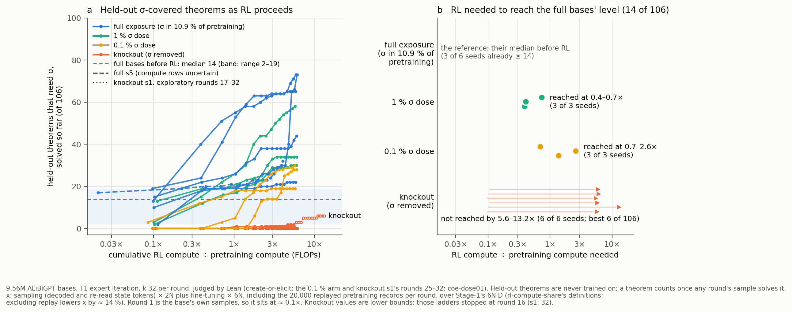

# coe-dose01: with 0.1 % σ in pretraining, RL brings σ back on 3 / 3 seeds, at 0.7–2.6× pretraining compute

**Models:** 9.56 M `best_model.ALiBiGPT` `lean_staten` provers, from scratch on K12^0.1% (155 σ records in 155,000),
seeds s0–s2, then 16 T1 expert-iteration rounds with the 1 % arm's protocol (`args.json` differs only in init, name,
data). Other rows: create-or-elicit's ladders.

**Capability:** 106 strict σ-covered held-out members (never trained on); bar 14 = the full bases' median before RL.

| pretraining | RL ÷ pretraining compute to reach 14 / 106 | seeds |
|---|---|---|
| full (σ 10.9 %) | none | 6 |
| 1 % σ | 0.39 / 0.41 / 0.73× (r2–r3) | 3 / 3 |
| **0.1 % σ** | **0.69 / 1.37 / 2.58× (r3, r5, r8)** | **3 / 3** |
| knockout | not reached by 5.6–13.2× | 0 / 6 |

- **Pre-registered reading: graded** — 3 / 3 cross; the median crossing (1.37×) is later than every 1 % seed's, though
  s2 (0.69×) overlaps the 1 % range (0.39–0.73×). Against the knockout:
  crossing 3 / 3 vs 0 / 6, Boschloo p = 0.0033; y r16 30 / 28 / 19 vs 0–3, Mann–Whitney p = 0.012. Against the 1 %
  arm (58 / 34 / 30) the gap is inside the pre-registered detectable difference (≈ 46).
- **Round 1:** free positive reductios 1 / 0 / 2, near the knockout's 0 (1 %: 170–219); held-out members 0 / 0 / 3
  (1 %: 3 / 13 / 2). EI amplified it to 464–1,116 per round by r16.
- **r16 plain reads (k 256):** 31 / 28 / 19 of 106; families acquired during RL: contraposition_conv on 3 / 3,
  negated_conditional on s0, s1. Lean re-check: 77 / 77 counted proofs accepted,
  all goal-negated copies rejected.
- **Knockout s1, r25–32:** y 5 → 6 by 13.2×; free reductios plateau (≈ 140 per round); r32 read 5 / 106.

**Expectations vs outcomes.** Hits: y r1 (0–3), crossing rounds, y r16 (3–45), "graded", x at r16, knockout s1 at r32
(6; 5–12). Misses: round-1 free reductios (0–2 vs ≥ 3), held-out greedy (0.84–0.89 vs 0.91–0.95), compute match
(0.94–1.10× vs 0.95–1.05×), knockout s1's r32 free reductios (143 vs ≥ 150). 3 / 3 crossed (point estimate 2 / 3).

**Caveats.** n = 3. Replay carries ≈ 20 σ records per round: part of the recovery may be replayed exposure. One
organism. No r16 guided read (budget).

**Cost:** $39.35 of $45 (66.70 A40 pod-hours). Details: `numbers.md` § coe-dose01.
