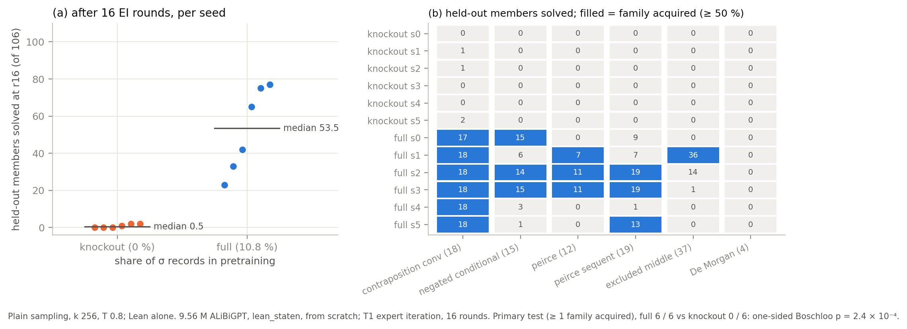
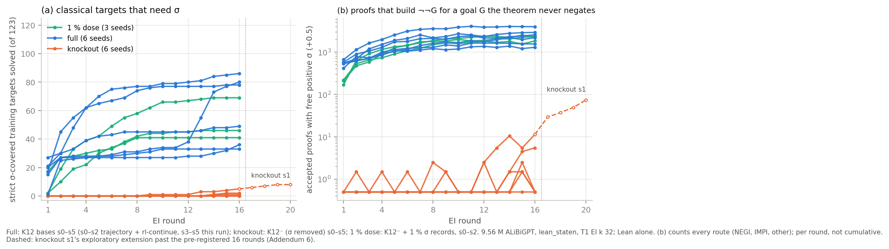

# create-or-elicit — did RL create it? (run summary, UNREVIEWED)

Models: 9.56 M ALiBiGPT, `lean_staten`, from scratch (`state_env_october` recipe), T1 expert iteration, 16 rounds; Lean
alone. Full = K12 bases (s0–s2 old, s3–s5 new); knockout = K12⁻, which drops the 16,961 records where double negation
eliminates a derived double negation (σ: classical reductio; 10.9 % of K12) and refills from K12's own unused records;
1 % dose = K12⁻ with 1,550 σ records put back. Numbers: `numbers.md` § create-or-elicit; log `log.md`.

**1. Classical families need σ in pretraining (pre-registered test).** On the 106 held-out members whose classical step
needs σ, full seeds solve 42 / 75 / 77 / 65 / 23 / 33 at r16 and knockout seeds 0 / 2 / 1 / 0 / 0 / 2. A family is acquired on
6 / 6 full seeds and 0 / 6 knockout seeds (Boschloo p = 2.4 × 10⁻⁴; families acquired *during* RL: 5 / 6 vs 0 / 6,
p = 0.002). Redraw and guided reads agree. Knockout bases lose nothing on non-σ theorems (held-out 0.950 vs 0.957).

**2. But σ is rare, not absent, without exposure.** 5 / 6 knockout ladders wrote the free reductio themselves (1–34
proofs in 16 rounds vs 17–50 thousand in the full arm); knockout s1's spread from r9 (DOSE_EXT_PLACEHOLDER). Four of six
knockout bases already reach a family member at ≈ 10⁻⁶ per attempt (2 / 6 certified out of reach at their budget), almost
all on contraposition_conv, whose premise ¬B → ¬A invites assuming ¬B. RL amplified a rare base behaviour; it did not turn
it into a family capability in 16 rounds.

**3. Sharpening does not reproduce RL.** Power sampling of the base (p^α, α 2 and 4; stable at 4× the MH steps) reaches
0 of the theorems RL creates at matched compute and 0 / 17 theorems the base solves rarely, where plain sampling at the
same tokens reaches 6–13.

**4. "Created" depends on the budget.** Five defensible budgets move the compute-matched set from 34 / 33 / 33 to
21 / 20 / 14; 18 / 17 / 8 survive all of them. The known-proof estimator is calibrated down to p ≈ 10⁻⁴ and a lower bound
below. RL's compute-matched gain on the 322 is similar in both arms (Δ_cov +32 to +37 full, +21 to +37 knockout).

**5. Dose.** DOSE_PLACEHOLDER

 

**Expectations vs outcomes.** Hits: knockout bases 0 / 106 and 0 strict targets at round 1; primary test; members-solved
medians; general ability except textbook72 (−6.5, a miss); the sharpening null; the budget restatement. Misses: σ first
appeared in round 1, not after round 4 (on theorems that name ¬¬G); the knockout certificate held on 2 / 6 bases, not ≥ 5;
negated_conditional on 1 / 3 new full seeds, not ≥ 2; Δ_cov above the +35 ceiling on 2 / 3. Deviations: strict σ-covered
definition (Addendum 2), budget cuts to the dose arm and Phase 3a (log 04:13, 08:23).
