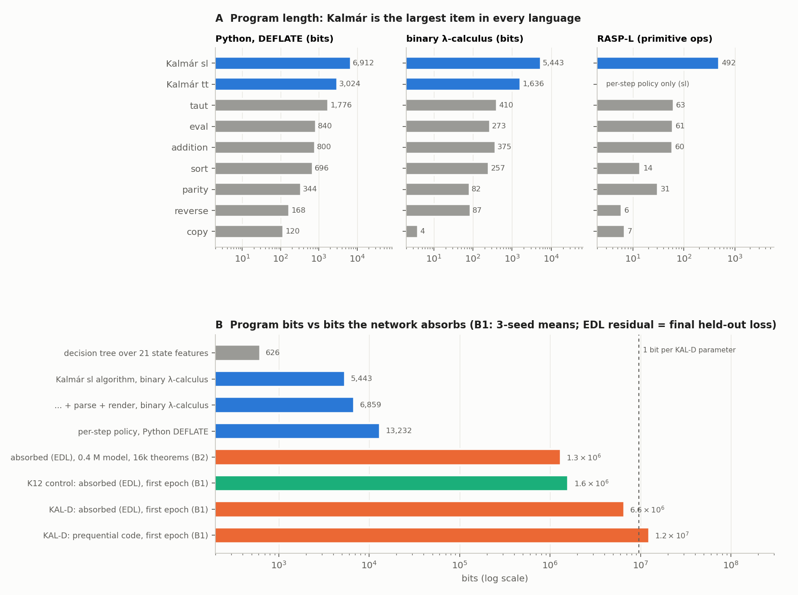

# run kalmar-complexity — how many bits is Kalmár's construction? (executor, 2026-10-20; UNREVIEWED)

**Question (Dan).** How many bits would a model have to absorb to learn Kalmár's construction, and which measure of
that predicts where it fails?

**Setup.**
- Programs that reproduce the builder exactly (≥ 1,000 K12 theorems, plus fresh seeds) in Python, binary λ-calculus
  (BLC) and RASP-L, and a decision tree.
- Bits absorbed: from kalmar-pretrain's logged curves (B1), and block-wise prequential runs (B2).
- Failure analysis: tf1200, 15 step types. Tables: `numbers.md` § kalmar-complexity.

1. **The program is a few kilobits in every language.**
   - K-sl (the trained variant), algorithm only: **5,443 BLC bits**; 864 B DEFLATE-compressed Python.
   - End to end: 6,859 BLC bits; 11.6 kbit Python in the model's `lean_seq` format.
   - The per-step policy: 13.2 kbit Python; RASP-L 492 ops, attention depth 41.
   - Decision tree: 626 bits, but only on top of features that hold most of the algorithm.
   - tt_prover's variant: 1,636 + 4,204 (Lean rendering) BLC bits.
2. **Kalmár is the largest item on every scale.** It is 13× taut in BLC; across languages ρ = 0.86–0.97.
   - But the calibration items do not order learnability. K12's generator is 2.2× Kalmár's length and learned easily;
     eval is 273 bits and slow to learn.
3. **The network absorbs ~1,000× the program.**
   - KAL-D's first epoch: 6.3–7.1 × 10^6 bits (EDL, held-out residual), 0.7 bits per parameter; the K12 control
     1.5–1.7 × 10^6.
   - B2: {{B2_HEADLINE}}.
4. **Per-step demand predicts failures; program length does not.**
   - Across step types:
     - RASP-L decision depth ρ = +0.85, in-scope lookups +0.82 (p < 0.001; both hold given frequency);
     - Python code length −0.55, and −0.08 given frequency;
     - frequency −0.60.
   - Within types, lookups add LR χ² 4,900–6,400 per seed.
   - "Wrong subformula" errors (45 %) track depth (+0.94); malformed outputs track formula length (+0.86).

   

**Recommendation.** Do not state "how much there is to learn" as a program length. That is ~5 kbit, moves by ~4×
between languages, and does not rank failures. State it as:
- a learner-relative EDL with its protocol (≈ 6.6 Mbit for KAL-D);
- plus a per-step demand profile (RASP-L depth or lookups) against the model's depth.

Evidence: strong but correlational — one architecture, three seeds, 15 types, one RASP-L program
(`next_steps.md` 1–2 are the causal tests).

**Expectations vs outcomes.** Held: Kalmár largest everywhere, B1 sizes, frequency, demand class. Missed: BLC
5,443 vs ≤ 5,000, RASP-L 492 ops / depth 41 vs ≤ 250 / ≤ 30; the specific predictors named (formula length, height);
"program length |ρ| < 0.4" (raw ρ −0.55, frequency). {{B2_PREREG}}

**Deviations.** Python tokens in Qwen3 / GPT-2 (our tokenizer cannot spell Python); B2 uses AdamW + early
stopping, not KAL-D's recipe; v2 patience added for eval / K12; L to 8,192 theorems.

**Spend.** {{SPEND}}
