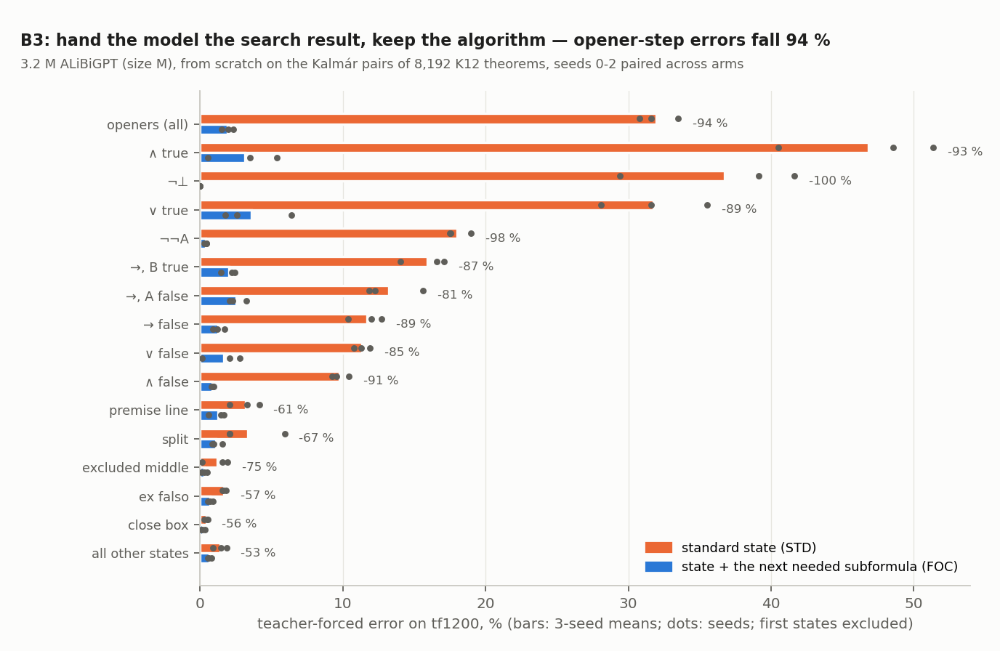

# run kalmar-complexity — how many bits is Kalmár's construction? (executor, 2026-10-20; UNREVIEWED)

**Question (Dan).** How many bits must a model absorb to learn Kalmár's construction; which measure predicts where
it fails?

**Setup.** Programs in Python, binary λ-calculus (BLC), RASP-L and a decision tree, exact on ≥ 1,000 K12 theorems;
absorbed bits from kalmar-pretrain's logs (B1) and new runs (B2); a causal test (B3). Tables: `numbers.md`.

1. **The program is a few kilobits.**
   - K-sl algorithm: 5,443 BLC bits, 864 B compressed Python.
   - End to end: 6,859–11,600 bits. Per-step policy: 13.2 kbit Python; RASP-L 492 ops, depth 41.
   - Decision tree: 626 bits, over features holding most of the algorithm.
2. **Kalmár is the largest item in every language** (13× truth-table checking in BLC; ranks agree, ρ 0.86–0.97).
   Size does not order learnability: K12's generator is 2.2× longer, learned easily; eval (273 bits) is slow.
3. **Networks absorb 200–1,300× the program.**
   - KAL-D's first epoch: 6.3–7.1 × 10^6 bits (EDL, held-out residual), 0.7 bits/parameter; K12 control 1.6 × 10^6.
   - B2 (0.4–9.6 M models): 1.1–1.5 × 10^6 per 16,384 theorems; the ≈ 0.02 bits/token floor needs only 10 % of the
     data.
4. **Per-step demand predicts failure; program length does not.**
   - Across types: RASP-L decision depth ρ = +0.85, in-scope lookups +0.82, B2 bits +0.85; code length −0.55
     (−0.08 given frequency). Also within types; wrong-subformula errors (45 %) track depth at +0.94.

   

5. **Causal (B3, 3 paired seeds):** showing the next needed subformula cuts opener errors 94 % (32 → 1.9 %); the
   demand–error correlation falls from +0.61 to −0.02. Same algorithm and proofs.

   

**Recommendation.** Not a program length (≈ 4× language-dependent; it does not rank failures), but a
learner-relative EDL with its protocol (≈ 6.6 Mbit for KAL-D) plus a per-step demand profile against model depth.
Evidence: strong for this architecture (three seeds, within-type effects, an intervention); untested on others.

**Expectations vs outcomes.** Held: Kalmár largest everywhere; B1 / B2 sizes; ≥ 100× absorbed; frequency; demand
predicts; B3. Missed: BLC 5,443 vs ≤ 5,000; RASP-L 492 / 41 vs ≤ 250 / ≤ 30; the named predictors (formula length,
height); EDL shape (eval plateaus, not Kalmár); B3's "other steps < 30 %" (−30 %).

**Deviations.** Python tokens in Qwen3 / GPT-2; B2: AdamW + early stopping (v2 patience for eval / K12), L to 8,192
theorems; B3 added (addendum 2).

**Spend.** $5.00 of $15 (8.46 A40 pod-hours).
