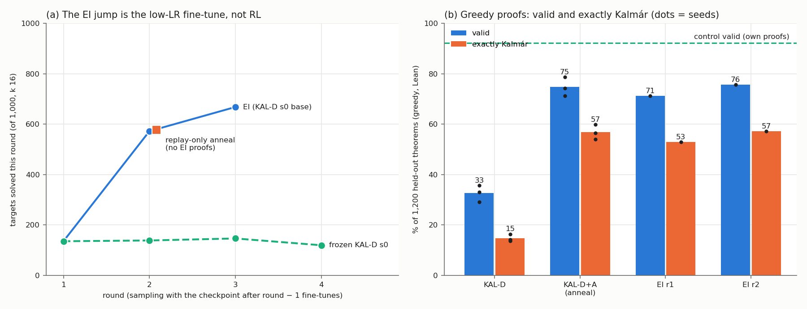

# run kalmar-pretrain — pretraining on Kalmár proofs (executor, 2026-10-20; UNREVIEWED)

**Question.** Does a proof-state model pretrained on Kalmár-construction proofs learn to run it, and generalise?

**Setup.**
- Data: Kalmár proofs of K12's 155,000 theorems (Lean 155,000 / 155,000). 109 actions per proof against 8.
- Model: 9.56 M best recipe, `lean_staten`, 3 seeds.
- Arms: **KAL-D** (data-matched, 3.68 epochs); KAL-C (compute-matched); **control** (K12).
- Lean decides. Tables in `numbers.md` § kalmar-pretrain.

1. **Pre-registered: not learned, and it did not generalise.**
   - Teacher-forced agreement with the algorithm: KAL-D 94.5 % (control 27.0 %).
   - KAL-D's greedy proofs: 32.6 % Lean-valid, 14.7 % exactly Kalmár. The control's: 92.2 % valid.
   - Plain pass@32: holdout250 33 vs 165; rr600 17 vs 246.
   - Errors were bookkeeping: 76 % write the wrong formula or a corrupted one.
2. **Exploratory (Addendum 3): most of the gap is the recipe's learning-rate floor.**
   - Setup: KAL-D+A = KAL-D plus 600 steps at lr 3e-4 → 3e-5 on 20,000 replayed Kalmár proofs.
   - Agreement 98.7–98.8 %; greedy valid 71–79 %, exactly Kalmár 54–60 %.
   - Greedy, KAL-D+A vs control:
     - holdout250 36.7 vs 38.1 %;
     - candidate_v0 37.9 vs 15.7 %;
     - G3 classical 35.2 vs 7.2 %.
   - Still not "learned": exact-follow at 1–2 atoms is 63–69 % against the 90 % bar.

   

3. **EI ladder** (KAL-D s0, 3 rounds):
   - Targets solved: 135 → 572 → 668 of 1,000 (frozen 119–146).
   - **The replay-only anneal alone solves 578**, so the jump is annealing, not RL.
   - EI keeps the algorithm (exactly Kalmár 14 → 57 %) and does not shorten proofs.

**Expectations vs outcomes.**
- Missed: every Kalmár-arm prediction (agreement ≥ 99.5 %, greedy ≥ 75–98 %, G1(b), G2, G3, "EI keeps ≥ 70 % exact").
- Untested: KAL-D pass@256.
- Held: the control's predictions, "guided ≥ plain" and "KAL-C < control".

**Deviations.**
- KAL-D reads and the ladder ran at batch 1,024 (OOM at 2,048).
- No k extension.
- The ladder stopped after 3 rounds (pod restart, budget).
- Truncated actions above 0.1 % were not re-read.
- Addendum 3 is exploratory.

**Spend.** SPEND_TOTAL of $50.
