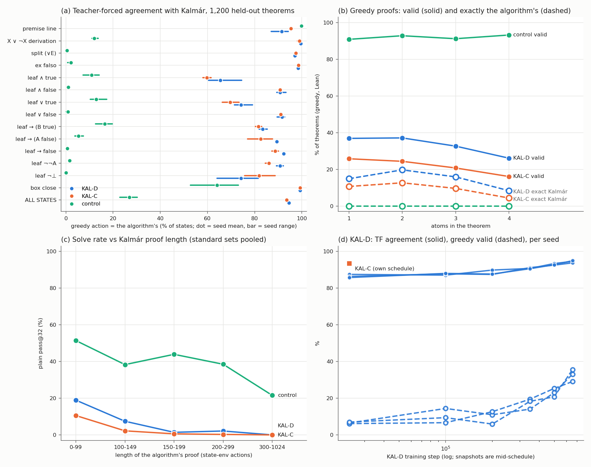

# run kalmar-pretrain — pretraining on Kalmár proofs (executor, 2026-10-19; UNREVIEWED)

**Question.** Does a proof-state model pretrained on Kalmár-construction proofs learn to run the construction, and
does it generalise?

**Setup.**
- **Data.** K12-Kalmár: Kalmár proofs of K12's 155,000 theorems. Lean accepts 155,000 / 155,000. 109 actions per proof
  against K12's 8; 27× the tokens.
- **Arms.** 9.56 M best recipe, `lean_staten`, 3 seeds each:
  - **KAL-D:** data-matched, 3.68 epochs.
  - **KAL-C:** compute-matched.
  - **Control:** best-cap12 Stage-1, trained on K12.
- Lean alone decides. Details in `numbers.md` § kalmar-pretrain.

1. **Not learned.**
   - Teacher-forced agreement with the algorithm on 1,200 held-out theorems: KAL-D **94.5 %** (93.8–95.0), KAL-C
     93.5 %, control 27.0 %.
   - Excluded-middle, split, ex-falso and closing steps are ≥ 97 %; leaf steps 65–92 %.
   - Greedy proofs: **32.6 %** Lean-valid, 14.7 % exactly Kalmár (4 atoms: 26.1 / 8.4 %). The control is 92.2 % valid.
   - The pre-registered criteria fail on every seed. Agreement was still rising when training ended (86.6 → 94.5 %).
2. **Errors are bookkeeping.**
   - Of KAL-D s2's 6,903 disagreements, 44.6 % write a formula of the problem that is not due next and 31.1 % a
     formula found nowhere in it. Only 1.4 % flip a truth value.
   - Errors cluster on particular theorems.
3. **Solve rates.** KAL-D vs control, plain / guided pass@32, mean of 3:
   - holdout250 33 / 59 vs 165 / 198; rr600 17 / 66 vs 246 / 425; textbook72 20 / 31 vs 24 / 35; hand_proved_14 0.
   - G2 (larger formulas): ≈ 0 for all arms.
   - **G3 classical: 18 / 30 vs 13 / 16 of 106.** The guided difference clears the MDD (+14 vs 11.5).
   - G1 (4–5 premises): within noise. With premise lines supplied the control solves 177–191 / 200, so the "premise
     wall" is the untrained `h4` token.
4. **EI ladder** from KAL-D s0 (4 rounds, cost rule): LADDER_RESULT.

**Expectations vs outcomes.** Every prediction for the Kalmár arms missed, by a wide margin: agreement ≥ 99.5 %;
greedy 75–98 %; large gains on holdout250, rr600 and hand_proved_14; G1(b), G2, G3 ≥ 90. Only the control's
agreement (≤ 40 %) hit. G3 has the right sign but a much smaller size than predicted.

**Deviations.**
- KAL-D sampled reads and the ladder ran at batch 1,024: 2,048 OOMs. The batch effect is ≤ ≈ 6 theorems.
- The k extension was dropped (spend gate), so KAL-D has no pass@256.

**Spend.** SPEND_TOTAL of $50.
