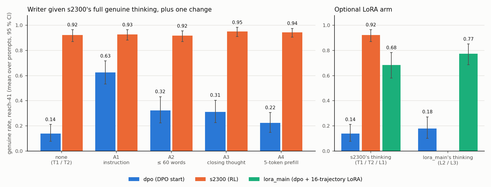

# olmo-answeronly — given RL's thinking, is the DPO start's failure only how it writes the answer?

**Setup.** `dpo` = Olmo-3-32B-Think-DPO, `s2300` = Olmo-3.1-32B-Think step 2300 (32 B, bf16). olmo-transplant's 115
stored genuine `s2300` traces (41 IFBench reach prompts) were re-inserted by token ids with one change; both writers
sampled only the answer (8 per trace). Grades: IFBench strict and blinded model readers. $9.27 of $30.

| reach-41, genuine [95 %] | `dpo` | `s2300` | R = dpo ÷ s2300 (prompts with s2300 ≥ 0.75) |
|---|---|---|---|
| none (T1 / T2, olmo-transplant) | 0.14 [0.08, 0.21] | 0.92 | 0.16 [0.09, 0.24] |
| A1 "reply with only your final answer, exactly as drafted…" | **0.63** [0.53, 0.72] | 0.93 | **0.68** [0.58, 0.78] |
| A2 "Answer in at most 60 words." | 0.32 [0.22, 0.43] | 0.92 | 0.37 [0.26, 0.49] |
| A3 closing line in the thinking | 0.31 [0.23, 0.40] | 0.95 | 0.34 [0.25, 0.43] |
| A4 first 5 answer tokens prefilled | 0.22 [0.15, 0.31] | 0.94 | 0.25 [0.17, 0.34] |

**Findings.**
1. **One instruction closes about 60 % of the gap.** A1 (chosen on calibration) adds +0.49 [0.41, 0.57] per prompt.
   `dpo` now copies the trace's answer exactly in 35 % of answers (T1: 5 %); 0 on 2 prompts (T1: 20).
   Pre-registered reading: **between** (0.40 < R < 0.75).
2. **The other changes help less** (R 0.25–0.37), and none breaks `s2300`. With A4, `dpo` runs past the draft or
   diverges from it in 90 % of answers, so reading 4 (the habit sits in the first tokens) fails.
3. **LoRA arm** (olmo-ifladder's `lora_main`, `dpo` + LoRA on 16 `s2300` trajectories): writing on `s2300`'s thinking
   0.68 (R 0.75 [0.65, 0.84], on the threshold); `dpo` on `lora_main`'s thinking 0.18 (`lora_main` itself 0.77).

**Answer.** Mostly a writing habit, with a remainder: told plainly, `dpo` turns RL's thinking into a genuine answer
two-thirds as often as RL does, and about 40 % of the gap survives the instruction.

**Against expectations.** `dpo` A1 was above its range (0.63 vs 0.15–0.60); R_A1 0.68 (expected 0.40). `dpo`'s A4 exact
stop share was 0.098 (range 0.10–0.50). Answers cut at the budget: ≤ 0.33 % per condition, but 2 / 24 and 1 / 24 in two
`dpo` (prompt, condition) cells. All else fell inside its range.

**Deviations.** A4 prefills min(5, n − 1) tokens on 5 short answers. One reading was fixed mid-gate (inline sub-bullets,
133 / 136; 2 labels overturned; without both prompts R_A1 = 0.67). Added L3 as L2's control.

