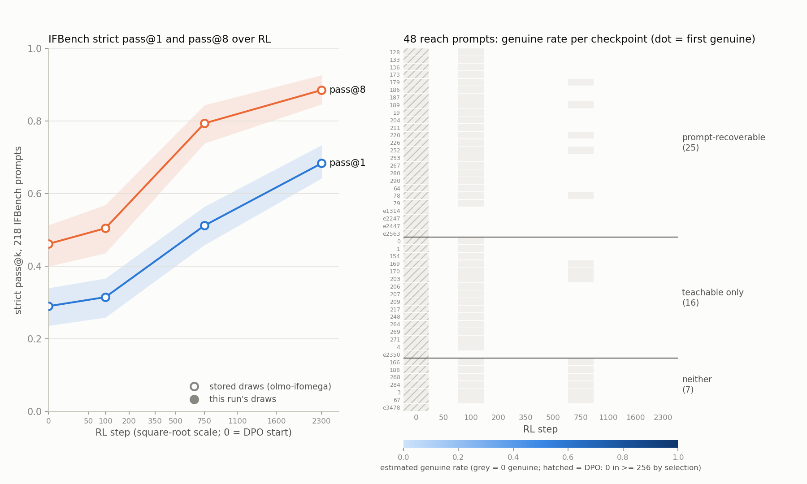

# olmo-ifcurve: instruction following over Olmo 3.1 Think 32B's RL run

**Question.** How do IFBench pass@k, the 48 IF reach prompts and the gamed share of checker wins change over RL?
`allenai/Olmo-3.1-32B-Think`, steps 50–2,300, plus its DPO start (step 0); s0350 cancelled (amendment 3).

**Aggregate (218 IFBench prompts).** Strict pass@1 rises at every checkpoint (within noise before step 100): 0.290 →
0.296 → 0.315 → 0.347 → 0.412 → 0.512 → 0.577 → 0.646 → 0.683. pass@8 reaches 0.872 by 1,100, then shows no detectable
gain. From 1,100, pass@1 gains 0.106 [0.080, 0.132] (90 %) and pass@8 0.014 [−0.018, 0.046]: **sharpening from 1,100**
on the checker score. Estimated genuine pass@1 (40 labelled wins per step) rises 0.25 → 0.51 by 1,100, then stays
near 0.50.

**Reach prompts.** All 48 get a first genuine success between steps 100 and 2,300 in their 32 base draws. Median
first-genuine step: prompt-recoverable 500, teachable-only 750, "neither" 1,100. The order is as predicted, but the
gap's 90 % interval (rest − prompt-recoverable: 250 [0, 600]) touches 0, so the pre-registered reading is **"no
order"**. On the second genuine success it is "habit first" (600 [350, 600]). None switches on abruptly: 10 climb
gradually, 26 are intermediate, 12 never show 8 genuine of 32. On 18 prompts the 128-draw cell before the
first genuine step already held one; median earliest detectable rate 0.039.

**Gaming.** On random checker wins the gamed share is "flat" by the pre-registered ±0.2 rule: 0.14 early (steps
≤ 200) vs 0.22 late (≥ 1,100). On the reach prompts it **grows**: 0.06 of 16 early wins vs 0.31 of 536 late wins
labelled.

**Lengths.** Median answers fall from 261 to 93 words by 750 and settle near 50 only at 1,600. 29 of 48 reach
prompts have two genuine successes by 750, so by the settling test: **not "brevity first"**.

**Expectations** (table in numbers.md). Missed: "habit first", gradual ≥ 50 % (28 %), arm-B "gaming first",
step-2,300 genuine on ≥ 44 / ≥ 40 prompts (40 / 36), cap share at 1,600 (0.63 %). The rest held.

**Caveats.** One run, one seed. The set was selected on step 0 failing and step 2,300 succeeding (other draws), so
reaching all 48 is largely built in. Arm A has 4 draws at 50 / 200. Rules 13–14 were added during the gate. Spend:
\$154.67 of \$160, including \$34.84 lost to orphaned pods.
