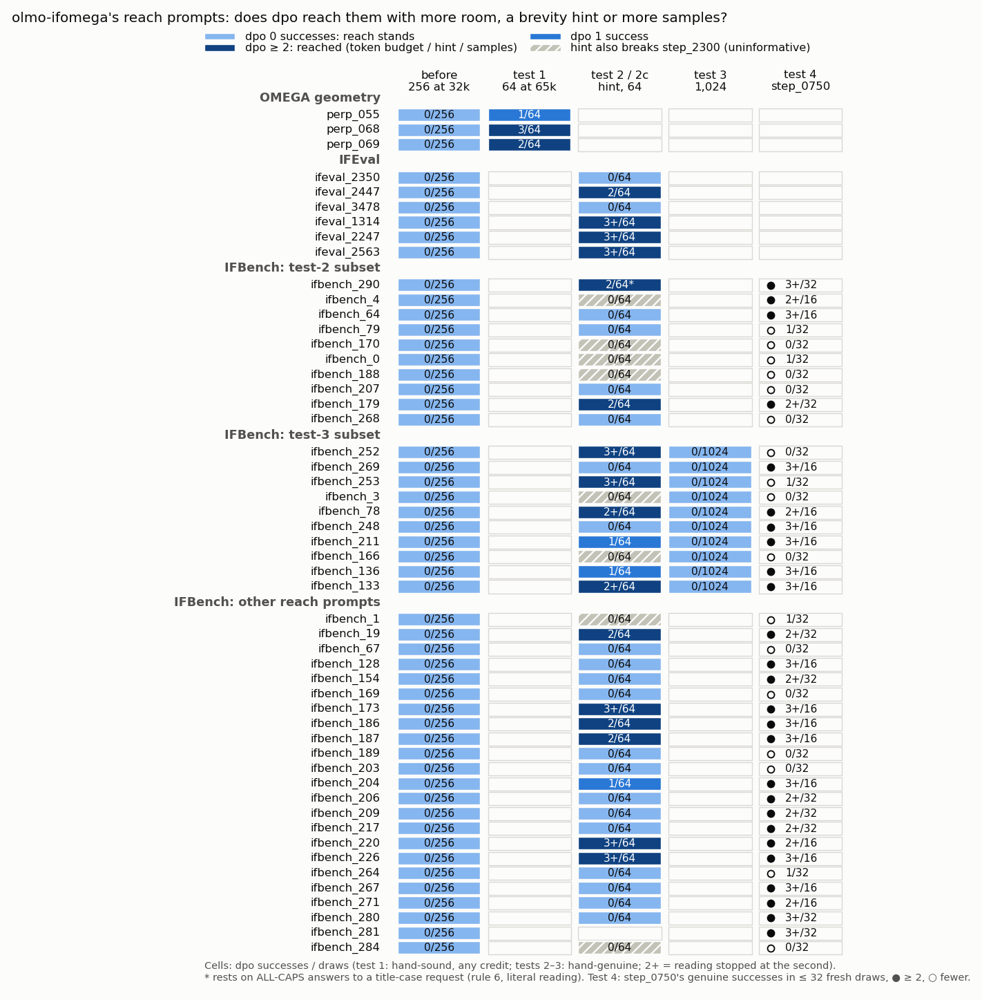

# olmo-iffu — is olmo-ifomega's "reach" a token budget, a brevity habit, or a sampling budget?

**Setup.** `dpo` = Olmo-3-32B-Think-DPO (RL's start); `s2300` / `s0750` = Olmo-3.1-32B-Think RL steps 2,300 / 750;
32 B, bf16, Think RL decoding; olmo-ifomega's 52 reach prompts (`dpo` 0 genuine in 256); official checkers plus a
blinded hand gate (368 items). $53.87 of $60.

**Findings.**
1. **Token budget (geometry).** Given 65,290 response tokens, `dpo` finishes 191 of 192 times (median ≈ 46k tokens)
   and is hand-sound on perp_068 3 / 64 and perp_069 2 / 64: "token budget". perp_055 (label corrected
   to 15): 1 / 64. Every credit lies past token 32,768. Solvable, not reliable: `dpo` 1.6–4.7 % per sample,
   `s2300` 28 / 40 at 32k.
2. **Brevity.** "Answer in at most 60 words." cuts `dpo`'s median answer from 231 to 60 words. `dpo` then reaches
   (≥ 2 genuine of 64) 4 of 6 IFEval reach prompts (2447 and all three all-caps; not 2350, 3478) and 12 of 42 IFBench
   ones (11 if ALL CAPS is not title case). On 8 more the hint also breaks `s2300`, so those say nothing.
3. **Samples.** On 10 IFBench prompts `dpo` has 0 genuine in 1,024 (≤ 2.9 × 10⁻³ per sample), yet 4 of them (78,
   133, 252, 253) are prompt-elicitable: rare under sampling, easy when told to be brief.
4. **`step_0750`** is confirmed on 26 of 43 IFBench reach prompts (≤ 32 fresh draws).

**Status of the 52** (follow-ups; prior verdicts stand): token budget 2; prompt-elicitable 16
(elicited, not created, by the capability standard); out of reach at 1,024 and with the hint 2 (248, 269); out of
reach at 1,024, hint inconclusive 4; one success with room or hint 2; not elicited by the hint, sampling untested 19;
hint uninformative 6; untested 1.

**Against expectations:** cut share at 65k 0.5 % (expected 65 %); test-3 survivors 10 of 10 (expected 6, 3–9); hint
harmless for `s2300` on 12 of 16 (expected ≥ 14). Within range: token budget 2 of 3, letter avoidance 1 of 3,
all-caps 3 of 3, IFBench subset 2 of 10, test 2c 10 of 32, `s0750` 26 of 43.

**Deviations:** test 2c (hint on 32 more IFBench prompts) pre-registered before sampling; test 4
capped at 32 draws (64 pre-registered) to afford it; `s2300`'s hint check read on until 2 genuine; rule 6 (ALL CAPS
counts as title case; strict reading reported).

