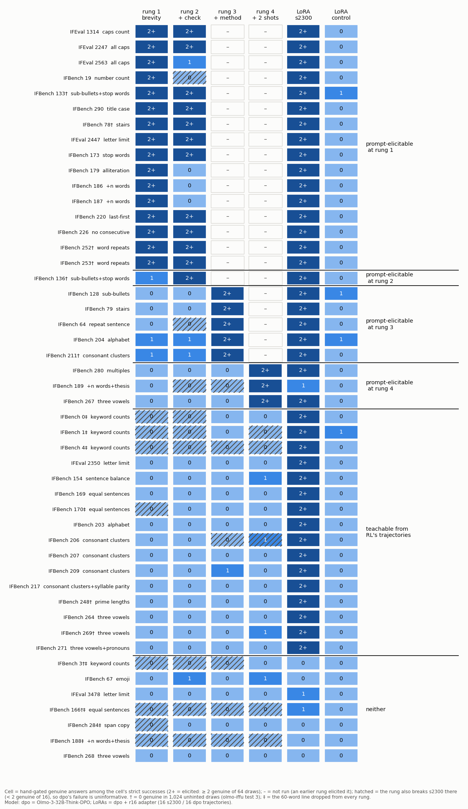

# olmo-ifladder — RL's IF reach, without RL

**Setup.** `dpo` = Olmo-3-32B-Think-DPO (RL's start), `s2300` = Olmo-3.1-32B-Think step 2300. 48 IF reach prompts
(`s2300` solves them; `dpo` 0 genuine in 256 draws), 10 calibration. A prompt ladder on `dpo` (64 draws per prompt);
two LoRAs of `dpo`, unhinted: `lora_main` on 16 genuine `s2300` trajectories of other IFBench prompts, `lora_ctrl` on 16
of `dpo`'s own. "Elicited" = ≥ 2 genuine of 64 (blinded readers). 19,456 draws; $61.85 of $80.

| reading (first that applies) | prompts |
|---|---|
| prompt-elicitable at rung 1 "≤ 60 words" / 2 + "check constraints" / 3 + method hints / 4 + 2 exemplars | 16 / 1 / 5 / 3 |
| **teachable from RL's trajectories** (`lora_main` yes, `lora_ctrl` no) | **16** |
| teachable by any light fine-tune | 0 |
| **neither** | **7** |

**Findings.**
1. **Prompting reaches 25 of 48** (290 at rung 2 if ALL CAPS ≠ title case). Check line +1, method hints +5 (mechanical
   constraints), exemplars +3.
2. **Sixteen RL trajectories reach 40 of 48 with no hint**, 16 beyond every rung (Fisher p < 0.05 vs the control on 12,
   estimated counts). **The control reaches 0.** `lora_main` reaches 19 of 23 prompts whose binding constraint type it never saw.
3. **`lora_main` also takes on RL's lengths:** median per-prompt thinking 6,236 tokens (`dpo` 1,834, `s2300` 5,742),
   answers 70 words (231 / 32). Gamed share 0.21 (`dpo`, rung 1: 0.15); calibration 0.975 (0.906).
4. **Neither (7):** IFEval 3478 and IFBench 3, 67, 166, 188, 268, 284. 3 and 166 also survived 1,024 draws; on 166
   and 188 every rung breaks `s2300`.
5. The four hint-elicited 1,024-survivors (78 133 252 253): `lora_main` all, `lora_ctrl` none.

**Against expectations.** Missed, all one way: `lora_main` 40 (expected 4), teachable 16 (1), neither 7 (21), its
thinking +240 % (±35 %), 1,024-survivors 4 (0). Undetermined: rungs breaking `s2300` (≥ 3 at rung 2, the bound).
Rest in range.

**Caveats.** The control matches examples, steps and recipe, not how far it moves `dpo` (held-out NLL 1 % vs 15 %);
`lora_main` trained on 1.41× the control's tokens, generated 1.71× (flagged). Causality of the lengths is untested.

**Deviations.** `s2300` sanity arm restored (read only on prompts no rung had elicited); LoRAs via vLLM's LoRA path (merge
check 1.12 % > 1 %); rules 10–12 added after all `dpo` / LoRA cells were decided.

