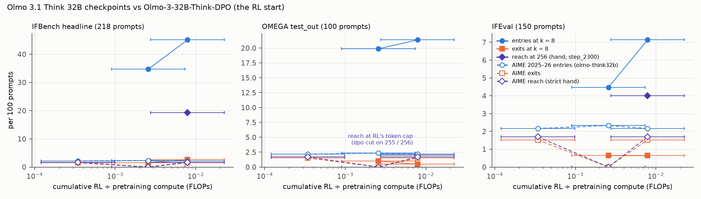

# olmo-ifomega — does Olmo 3.1 Think 32B's RL create reach where RL moved it?

**Setup.** RL start `allenai/Olmo-3-32B-Think-DPO`; `allenai/Olmo-3.1-32B-Think` `step_0750` and `main` (= `step_2300`);
Think RL decoding (T 1, top-p 1, 32,768 tokens). IFBench (218 headline prompts), IFEval (150), OMEGA `test_out` (100).
Grades: official IF checkers; OMEGA exact match and RL's verifier; blinded hand check (505 items, all confirmed).
Reach = step 2,300 confirmed, DPO 0 successes in 256 samples.

| pass@1 [95 %] / pass@8 | DPO | step 750 | step 2,300 |
|---|---|---|---|
| IFBench strict | 0.29 [0.24, 0.34] / 0.46 | 0.51 / 0.79 | 0.68 [0.64, 0.73] / 0.89 |
| IFEval strict | 0.77 / 0.91 | 0.89 / 0.95 | 0.93 / 0.97 |
| OMEGA `test_out` | 0.27 [0.21, 0.35] / 0.52 | 0.55 / 0.71 | 0.62 [0.54, 0.71] / 0.73 |

**Findings.**
1. **IFBench: Reach**, 42 prompts by hand (49 strict). 36 % of step 2,300's first-checked successes are gamed
   (minimal text meeting the constraint); on 11 more prompts its strict reach is gaming only.
2. **IFEval (in-distribution control): Reach too** (expected 15 %), 6 prompts, all letter-avoidance or all-caps
   constraints RL trained on. DPO misses letter avoidance by far and slips into lowercase on all caps; step 2,300
   passes with 5–15× shorter answers.
3. **OMEGA `test_out`: inconclusive by hand** (exact match: Reach, via a wrong label). DPO resolved 8 of 14
   candidates; the 2 reach prompts (perp_068, perp_069) are **reach at RL's token cap**: DPO hits 32,768 tokens on
   255 of 256 samples each. perp_055's label is wrong (17; correct 15); corrected, it is a third.
4. **DPO's IFBench failures are substantive**: on the 49 zero-success prompts 93 % ignore or miss the binding
   constraint by far; on geometry 99 % hit the token cap.
5. IFBench reach is not concentrated near RL's IF data (binding constraints without an RL analogue: 48 % vs 38 %).
   RL compute at step 2,300: 0.8 % of pretraining.

**Against expectations:** pass@1 in range except RL on `test_out` (0.62 vs 0.40); DPO resolved 1 of 8 IFEval
candidates (75 % expected); gaming far above ≤ 10 %; failures more substantive (93 % vs 60 %).

**Deviations.** `step_0100`, `test_in` and intermediate-checkpoint confirmation cut; budget raised twice ($225, $325);
hand rule 5 added.

**Cost** $293.84 of $325 (77.9 pod-hours; 339 M generated tokens). Memo: `olmo_ifomega/scaleup_memo.md`.

