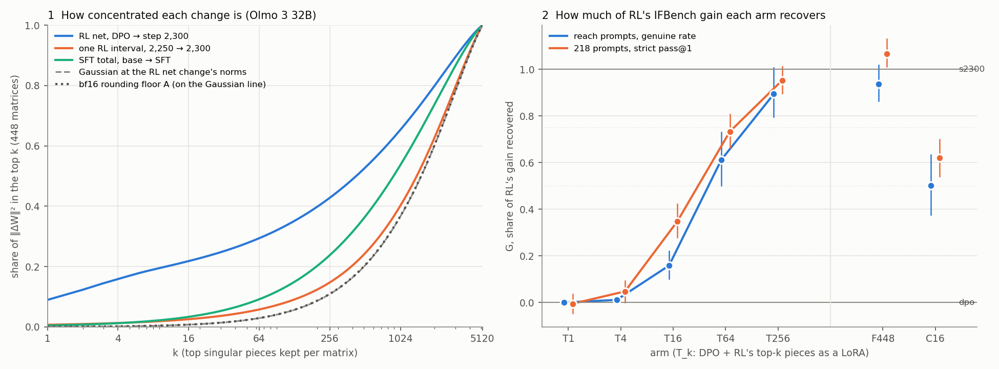

# Run olmo-lowrank: RL's change to Olmo 3 32B is spikes on a floor; its top 64–256 pieces carry the gain

Released AI2 checkpoints (bf16, none trained here): Olmo 3 32B (32.2 B) base, SFT, DPO (`dpo`), 3.1 Think RL step
2,300 (`s2300`); Olmo 3 7B for spectra. $55.98 of $80.

**Spectra (448 matrices).** RL's net change (`dpo` → `s2300`) is spikes on a floor:
- the top 16 / 256 pieces per matrix hold 22 % / 43 % of ‖ΔW‖² (noise and bf16-rounding baselines: 0.75 % / 11 %);
- the median matrix has 227 directions above same-norm rounded noise;
- it grows over RL (3.3 % → 22 %), partly via a near-rank-1 jump at steps 1,100–1,150.

SFT's change is diffuse (3.3 %), DPO's most concentrated (35 %); 7B agrees.

**LoRA.** `lora_main`'s median overlap with RL's top-16 subspaces: 0.016 (random 0.003, `lora_ctrl` 0.007). Its cosine
with RL's change: 0.0052, and 0.0086 against the top 16.

**Truncation.** T_k = `dpo` + RL's top k pieces per matrix (exact SVD, as a LoRA); F448 = `dpo` with `s2300`'s 448
matrices; C16 = F448 minus the top 16. G = share of RL's gain recovered on R (48 reach prompts, hand-gated genuine
rate; fresh `dpo` 0 / 768) and A (218 prompts, strict pass@1):

| G | T1 | T4 | T16 | T64 | T256 | F448 | C16 |
|---|---|---|---|---|---|---|---|
| R | 0.00 | 0.01 | 0.16 | 0.61 | 0.90 | 0.94 | 0.50 |
| A | −0.01 | 0.05 | 0.35 | 0.73 | 0.95 | 1.07 | 0.62 |

95 % half-widths ≤ 0.13.

**Readings: none holds (all firm).**
- "Low-rank carries it" fails: T16 recovers too little and the floor alone (C16) too much.
- "High-rank" fails: T256 recovers nearly everything.
- "Outside the 448" fails: F448 recovers everything.
- k₅₀ = 64, below the median spike count (227).

**Expectations.**
- Hits: E3, E6; E4's T16 < 0.3, F448 ≥ 0.75 and C16 ≥ 0.5 (tentative).
- Misses: P1 (intervals 3.4–3.8× floor A), P2 (T16 0.16), P3 (overlap 0.016), E1–E2 (RL more concentrated than SFT),
  E4's "high-rank" call, E5 (main only 2.2× ctrl).

**Gate.** 1,400 items, 1,802 reads; 90 % of double reads agree; gamed share 0.11–0.32 (arms with ≥ 65 successes).

**Compute.** 1,472 draws per arm; T16–C16 used ≤ 1.43× `dpo`'s tokens, ≤ 2.5× its H200-seconds.

Details: `numbers.md` § olmo-lowrank; `olmo_lowrank/plain_summary.md`.
