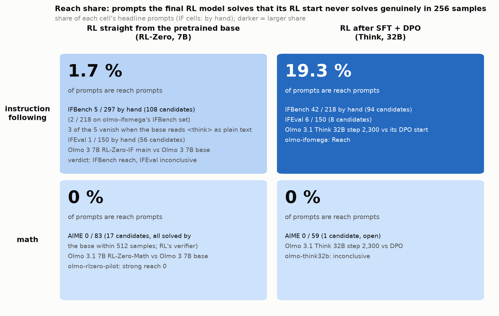

# olmo-rlzero-if — does RL straight from the pretrained base create instruction-following reach?

**Setup.** Base `allenai/Olmo-3-1025-7B` `main` against `allenai/Olmo-3-7B-RL-Zero-IF` `step_100`, `step_500`, `main`
(≈ one increment past `step_1900`): 7 B, RLVR on IF prompts from the base. The released run's recipe (`olmo_thinker`,
T 1, top-p 1, 16,384 tokens) and tokenizer for every model; IFBench 297 (3 RL near-duplicates excluded), IFEval 150;
official checkers on RL's answer extraction; blinded hand gate (1,527 responses). Reach = `main` hand-confirmed, base
no genuine success in 256.

| strict pass@1 / pass@8 | base | `step_100` | `main` |
|---|---|---|---|
| IFBench | 0.13 / 0.33 | 0.48 / 0.65 | 0.47 / 0.58 |
| IFEval | 0.20 / 0.50 | 0.81 / 0.88 | 0.82 / 0.86 |

**Findings.**
1. **RL-Zero-IF learns to game the checker.** By step 100 answers shrink from ≈ 2,300 to ≈ 40 tokens; 94 % of
   `main`'s first-read strict successes are placeholders or skeletons (32B Think run: 36 %). `main` is hand-confirmed
   on 10 of 164 reach candidates.
2. **Verdict (pre-registered): IFBench "Reach" (5 prompts by hand, 6 strict); IFEval inconclusive (1).** All six are
   format prompts (a bare option, a 7-row CSV, repeat-the-request); steps 100 and 500 already reach them.
3. **Half of it is a tokenizer artifact.** RL's tokenizer makes `<think>` a token the base never saw; the base almost
   never closes its reasoning (46 of 7,200) or answers bare. Reading `<think>` as text, it answers genuinely on 3 of
   the 6.
4. Base failures there: no usable answer 54 %, constraint ignored 21 %, far off 25 %.
5. RL-Zero-Math solves none of the IFBench reach prompts (0 / 160).

**Answer.** From the base, IF RL buys almost no genuine reach — 3 robust format prompts of 447 — and mostly learns to
game; after SFT the 32B run reached 42 / 218 IFBench prompts. The IF/math split looks like a property of SFT, not of
the domain (caveat: 7B vs 32B, different RL data).

**Expectations vs outcomes.** Base pass@1 and candidates inside their ranges; `step_100` far above (0.48 vs 0.10);
gaming 94 % (expected 80 %); `main` confirmed on 6 % (expected 25 %); 52 reverse candidates (expected 8). By hand
IFBench Reach (given 40 %), IFEval inconclusive (40 %); strict IFEval inconclusive (Reach was 85 %; tier 2 cut).

**Deviations.** Challenger reading order; hand rule 7; tier 2 cut to 10 per task; reverse reading capped; full math
arm voided (≈ $9); start-revision margin 6× (10× planned).

**Cost** $24.58 of $40 (17.0 A100 pod-hours, 43.8 M tokens).

