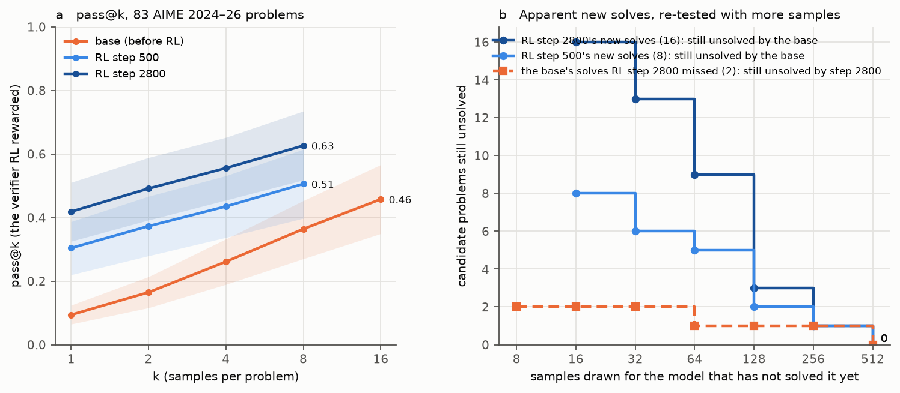
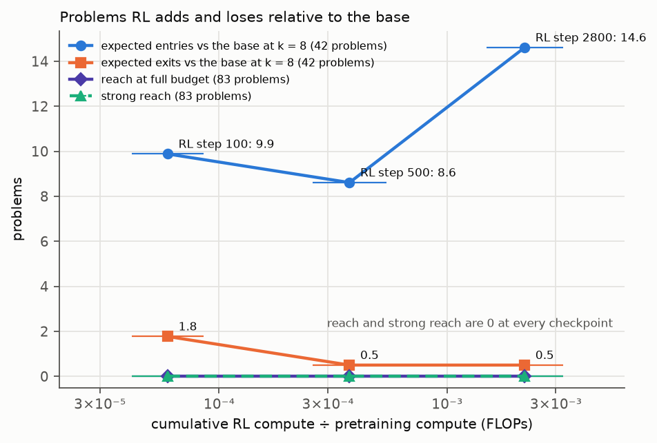
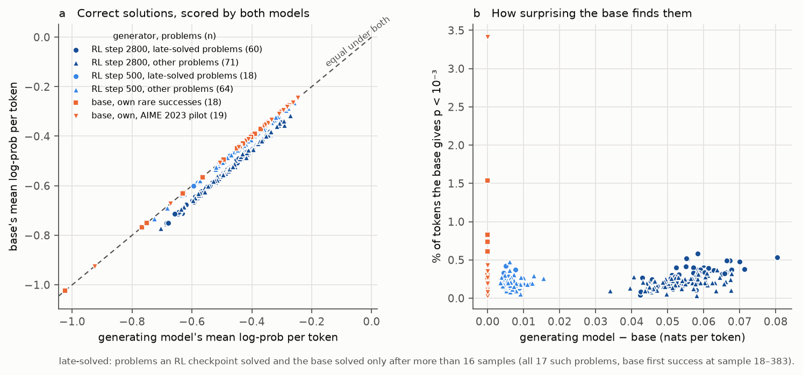

# olmo-rlzero-pilot — does RL from the base create reach along Olmo 3.1 7B RL-Zero-Math's trajectory?

**Models.** Base `allenai/Olmo-3-1025-7B` `main` (7.3 B, pretrained; RL-Zero's start — `step_0100` is 2.6 × 10⁻⁴ from
it in weight space) and RL-Zero-Math `step_0500`, `step_2800` (= `main`), RLVR on Dolci-RL-Zero-Math-7B. Natural-language
maths, no Lean: a sample counts iff open-instruct's `MathVerifier`, run the way RL ran it, accepts its answer.

**Setup** (pre-registered, Parts A/B). 83 AIME 2024–26 problems (7 excluded for contamination). RL's template, T 1,
top-p 1, 16,384 tokens; vLLM 0.11 bf16 with n-gram speculation (gate: 1.36×, outputs unchanged). Base 16, RL 8
samples per problem; RL-only solves re-tested by sampling the base until its first success, up to 512; the reverse
the same for step_2800.

| 83 problems, `rl` grade, 95 % CI | pass@1 | pass@8 | pass@16 |
|---|---|---|---|
| base | 0.094 [0.065, 0.124] | 0.364 [0.270, 0.453] | 0.458 [0.349, 0.566] |
| step_0500 | 0.304 [0.220, 0.387] | 0.506 [0.398, 0.615] | — |
| step_2800 | 0.419 [0.325, 0.510] | 0.626 [0.518, 0.735] | — |

**Findings.**
1. RL raises pass@1 4.5×; at k = 8 step_2800 gains 22.8 expected problems over the base and loses 1.0
   (step_0500: 14.0 / 2.3). ⟨S100⟩
2. **None of it is new reach at this budget.** All 17 problems an RL checkpoint solved and the base did not (0 / 16)
   were solved by the base when re-sampled, at draw 18–383 (median 73), each a full solution with a correct
   "Answer:" line. The 3 problems the base solved and step_2800 did not were solved by step_2800 at draws 12–280.
   Strong reach 0, reverse 0 (figure 1b).
3. **RL's solutions are in the base's support.** On the late-solved problems all 78 RL solutions lie inside the base's
   own-solution likelihood range; the per-token gap is 0.057 nats at step 2800 and 0.006 at step 500, the same as on
   other problems (figure 3).
4. Candidates are no closer to the RL data by n-gram (p = 0.33); by embedding, slightly (0.71 vs 0.65, p = 0.02).

**Expectations vs outcomes.** Base and RL pass@1 were above the pre-registered ranges (0.03–0.08, 0.10–0.25);
throughput 1.5–2× below. Reach after pass 1 was 3 (expected 2–8), then 0. **Verdict by the pre-registered rule:
inconclusive.** Its reach half holds (strong reach 0 ≤ reverse 0) and so does its pass@k half on the candidates
(base 17 / 17 at its extension budget), but not at k = 8 on all problems (pass@8 gap 0.26 [0.18, 0.35]) — a clause
sharpening alone fails. By reach, the criterion the rule was built for: elicitation only, up to 512 samples.

**Deviations.** step_0100 dropped from the full set for budget after a host failure ⟨half-set⟩; confirmation 24 → 16
(step_2800) / 8 (step_0500); step_2800 also extended on aime2025_22 (symmetry); the base's phase-F texts lost with a
pod (grades kept).

**Cost** ⟨$⟩ of $50; 32B memo `olmo_pilot/decision_32b.md` (≈ $110–320).

