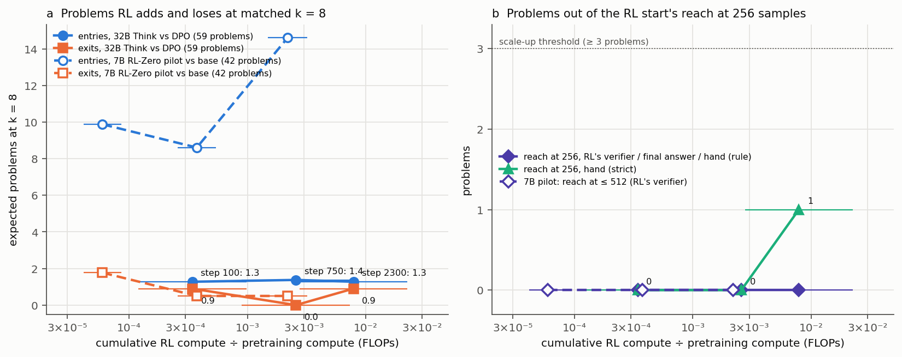

# olmo-think32b — does Olmo 3.1 Think 32B's long RL run reach AIME problems its DPO start cannot, within 256 samples?

**Models.** RL start `allenai/Olmo-3-32B-Think-DPO` `main`; `allenai/Olmo-3.1-32B-Think` `step_0100`, `step_0750`
(= Olmo 3 Think 32B), `main` (= `step_2300`) — one continuous RLVR run, 32 B, bf16, pretrained. AIME 2025–26, 59
problems; the Think RL template and decoding (T 1, top-p 1, 32,768 tokens). Grades: RL's MathVerifier, final stated
answer, blinded hand check.

| 59 problems, RL's verifier | pass@1 | pass@8 |
|---|---|---|
| DPO | 0.716 [0.62, 0.81] | 0.858 [0.76, 0.94] |
| step 100 / 750 / 2,300 | 0.706 / 0.748 / 0.746 | 0.864 / 0.881 / 0.864 |

**Findings.**
1. RL moves little here: step 2,300 is +0.030 [0.000, 0.060] pass@1 over DPO (+0.053 by final answer), with ≈ 1.3
   expected entries and 0.9 exits at k = 8.
2. **One reach candidate**, aime2025_28: DPO 0 / 16, every RL checkpoint ≥ 1 / 8. At 256 samples DPO is credited 7
   times by RL's verifier but states the answer once (it says 208 in 70 of 240 extension samples); step 2,300 states it
   in 10 of 40. By hand, DPO has one sound stated solution (none under a strict reading that rejects residue-representative
   arguments); step 2,300 has rigorous ones.
3. **No reverse problem**: aime2026_14 (DPO 3 / 16, step 2,300 0 / 8) fell to step 2,300 within 56 draws.
4. RL's solutions are in DPO's support: all 29 inside DPO's own per-token range, and *more* likely per token than DPO's
   own (+0.14 nats at step 2,300).

**Verdict (pre-registered): inconclusive** under the final-answer and hand grades (DPO confirmed only by RL's verifier,
where the verdict is "no reach at 256"). "Reach for scale-up" needed ≥ 3 problems; there is one. At up to 2.3 × 10⁻²
of pretraining FLOPs (0.14 of GPU-hours), this RL sharpens rather than extends, except possibly on aime2025_28.

**Expectations vs outcomes.** pass@1 inside the expected ranges; the RL gain below them (+0.03 vs +0.05–0.12); tokens
near the top (19.9k vs 14k); reach candidates 1 (expected 3), reverse 1 (expected 1); verdict inconclusive (the
modal expectation); likelihood inside DPO's range (expected), gap larger than expected and positive.

**Deviations.** One H200 secure per job (no cheaper capacity); Stage 0 without its RL job ($8 cap); hand-check rule
fixed mid-run for one recurring step and applied to both sides (strict reading also reported); step_0750's confirmation
@@S0750@@.

**Cost** @@COST@@ of $150; memo `olmo32/scaleup_memo.md` (aime2025_28 to 1,024 ≈ $27–40).

