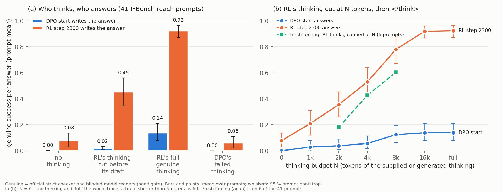

# olmo-transplant — is Olmo 3.1 Think 32B's new IF capability in its thinking?

**Setup.** `dpo` = Olmo-3-32B-Think-DPO (RL's start), `s2300` = Olmo-3.1-32B-Think step 2300 (32 B, bf16). 41 IFBench
reach prompts (`olmo-ifomega`) and 10 calibration prompts. Stored thinking was re-inserted by token ids; only answers
were sampled (17,472). Grades: IFBench strict and blinded model readers. $17.82 of $60.

| reach-41, genuine [95 % prompt bootstrap] | `dpo` answers | `s2300` answers |
|---|---|---|
| no thinking (T0) | 0.00 | 0.08 [0.03, 0.14] |
| `dpo`'s failed thinking (T4 / T3) | 0.00 | 0.06 [0.02, 0.11] |
| `s2300`'s thinking cut before its final draft (P) | 0.02 | 0.45 [0.35, 0.56] |
| `s2300`'s full genuine thinking (T1 / T2) | **0.14** [0.08, 0.21] | **0.92** [0.87, 0.97] |

**Findings.**
1. **The thinking alone does not carry the capability.** With RL's full thinking, `dpo` scores 0.14 against 0.92
   (0 on 20 of 41 prompts). Its answers have a median of 126 words against RL's 26. 183 of the 256 that contain RL's
   drafted answer verbatim add text that breaks the constraint. Calibration prompts transplant
   fine (0.99 vs 1.00 strict).
2. **Neither does RL's answer writing alone.** RL scores 0.08 without thinking and 0.06 after `dpo`'s failed thinking.
   It takes both together.
3. **Budget: graded.** RL with its thinking cut at 1k / 2k / 4k / 8k tokens: 0.21 / 0.36 / 0.53 / 0.78. `dpo` stays
   ≤ 0.12 throughout. Fresh forcing (RL thinks, capped; 6 prompts): 0.27 / 0.62 / 0.88 of its natural rate.
4. **The draft helps but is not required.** P gives 0.45, or 0.28 when the 28 % of answers that re-open thinking count
   as failures (post hoc).

**Pre-registered readings.** "In the thinking" (1) and "answer writing" (2, which needs T3 ≥ 0.22) both fail, so the
result is "partly" (3), with a graded curve (6). "Needs long search" fails: 0.33 of the gain is retained at 2k (> 0.25).
For claim 4, RL's thinking is necessary but not sufficient: the DPO start cannot turn it into a constrained answer.

**Against expectations.** Below range: T1 (expected 0.55, range 0.30–0.80) and `dpo`'s curve at 4k and 8k. Above
range: RL at 2k. The draft effect was +0.16 (expected ≥ 0.30). Everything else fell inside its range.

**Deviations.** All 41 reach prompts instead of ≈ 20 (`brief20` agrees); added T4, P and F(4k).

