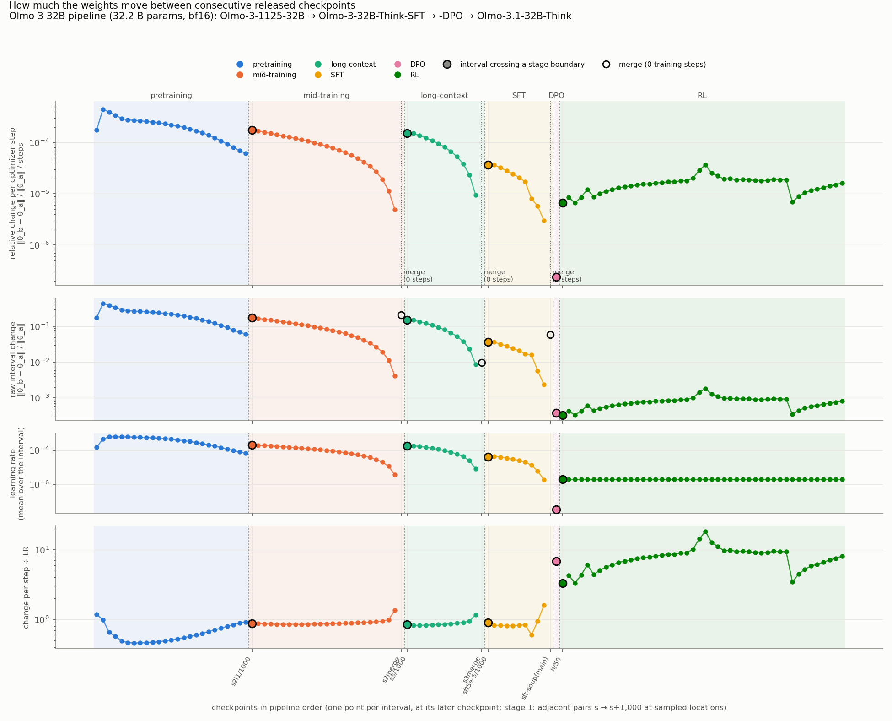
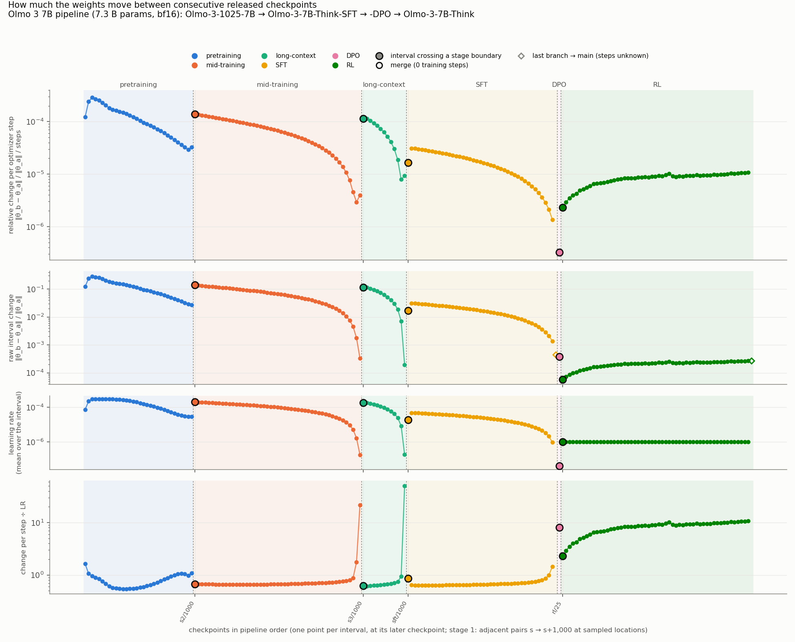

# Run olmo-weights: how much Olmo 3's weights move at each stage of training

Released Olmo 3 checkpoints (AI2, bf16; none trained here):
- **32B** (32.2 B params): base → Think SFT → DPO → 3.1 Think RL.
- **7B** (7.3 B params): base → Think SFT → DPO → Think RL, plus RL-Zero runs from the base.

453 checkpoints (15.2 TB) on A40 pods; $3.77 of $50.

**The stage switches are obvious, and the learning rate sets the per-step size.** From pretraining through SFT, the
median relative change per step is 0.57–0.87 × the LR (1,000-step intervals, both models).

**RL breaks this pattern.** At a constant LR, its change per step grows to about 8–9 × the LR. Most weights do not move
in bf16 between RL checkpoints (80 % per 50 steps for 32B, 92 % per 25 steps for 7B). Of those that do, at least three
quarters move by one rounding step or less.

**Size.**
- RL's change per step is only 1.3–1.9× smaller than SFT's (expected ≥ 10×: **miss**).
- RL's consecutive changes point against each other (cosine −0.2), so it is less straight than SFT: S = 0.10 vs 0.39
  (32B) and 0.07 vs 0.21 (7B) (**miss**).
- Its total move from DPO, 0.36 % of ‖θ‖ (32B) and 0.08 % (7B), is 31–185× smaller than SFT's (**hit**).
- 65 % (32B) and 88 % (7B) of weights end within one rounding step of DPO (**hit**).

**Where.** Attention and MLP matrices move 1.1–1.9× the model average in every stage; norms barely move. DPO's jump
concentrates on attention (32B: 2.2–2.7×).

**LoRA.** olmo-ifladder's 16-example adapter points along RL's change: cosine 0.0053 at step 2,300, about 1,000
random-baseline sd above chance, against 0.0002 for the control (**hit**). The alignment grows as RL proceeds. The
adapter is 0.47× the size of RL's final change.

**Checkpoint findings.**
- The released 32B SFT (also filed as `5e-5-step8000`) is the equal-weight soup of both learning-rate runs' final
  steps, and DPO started from it.
- Stage 3 started from the stage-2 merge.
- Five RL-Zero branch names hold misfiled weights (excluded).

**Expectations: 7 of 12 hit.** The misses:
- E1 and E4 (above);
- G4: the stage-3 merge is the equal-thirds average, but bf16 rounding exceeded my 1 % residual threshold;
- G5: DPO did start from the released SFT;
- G7: RL-Zero Code.

Details: `numbers.md` § olmo-weights; `olmo_weights/plain_summary.md`; Figures 2–7: `artifacts/olmo_weights/figures/`.
